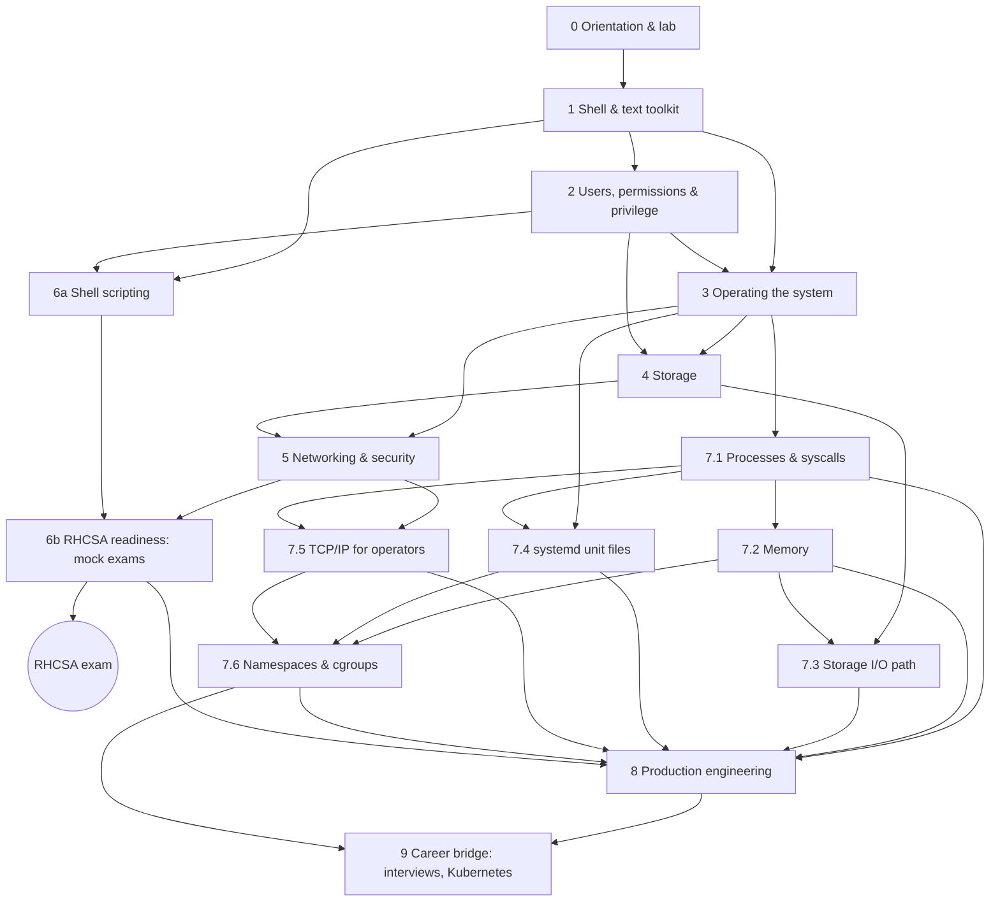

# Linux Mastery Curriculum: From First Shell to Platform Engineering

> The **learning order** for this knowledge base. The topic folders are the **reference library** (look things up by subject); this file tells you **what to study, in which order, why, how to practise, and when to move on**.
> **Baseline:** RHEL 10.x · EX200 objectives re-checked against Red Hat's exam page on 26 Oct 2026 (62 objectives in 10 categories; unchanged from the [objectives map](rhcsa-exam-labs/exam-objectives-map.md)).
> **Companion files:** [ROADMAP](ROADMAP.md) (tick-box study checklist) · [COVERAGE](COVERAGE.md) (objective and skill coverage) · [GAPS](GAPS.md) (what isn't covered or verified) · [CHANGELOG](CHANGELOG.md) · [README](README.md) (reference index)

## Table of Contents

1. [How to Use This Curriculum](#1-how-to-use-this-curriculum)
2. [The Roadmap at a Glance](#2-the-roadmap-at-a-glance)
3. [Prerequisite Map](#3-prerequisite-map)
4. [Phase 0: Orientation & Lab](#phase-0-orientation--lab)
5. [Phase 1: The Shell & Text Toolkit](#phase-1-the-shell--text-toolkit)
6. [Phase 2: Users, Permissions & Privilege](#phase-2-users-permissions--privilege)
7. [Phase 3: Operating the System (Software, Processes, Services, Boot)](#phase-3-operating-the-system-software-processes-services-boot)
8. [Phase 4: Storage](#phase-4-storage)
9. [Phase 5: Networking, Remote Access & Security](#phase-5-networking-remote-access--security)
10. [Phase 6: Shell Scripting & RHCSA Exam Readiness](#phase-6-shell-scripting--rhcsa-exam-readiness)
11. [Phase 7: Linux Internals](#phase-7-linux-internals)
12. [Phase 8: Production Engineering](#phase-8-production-engineering)
13. [Phase 9: Career Bridge (Interviews, Kubernetes, Next Certifications)](#phase-9-career-bridge-interviews-kubernetes-next-certifications)
14. [Learning Sequence vs Reference Structure](#14-learning-sequence-vs-reference-structure)
15. [Study Method & Pacing](#15-study-method--pacing)

---

## 1. How to Use This Curriculum

**Tracks** (labels used inside every note):

| Label | Meaning | Needed for |
|---|---|---|
| **[RHCSA Core]** | Maps to a current EX200 objective | The exam |
| **[Interview Knowledge]** | Core Linux fundamentals and concepts: the "why" | Every interview, real understanding |
| **[Internals]** | How the kernel and system actually work underneath | Troubleshooting, senior/SRE interviews, containers |
| **[Production Practice]** | Real-world administration, hardening, operations | Jobs, production troubleshooting |
| **[Advanced/Optional]** | Useful, outside EX200, lower priority | Breadth |

**Rules of the curriculum:**

1. **Follow the phases in order.** Each phase only uses concepts introduced earlier. Inside a phase, follow the numbered order.
2. **Practise every note in your lab** (two RHEL 10 VMs from Phase 0). Reading without typing doesn't count.
3. **Move on only when you meet a phase's exit criteria**, without notes. If you can't, repeat the labs, not the reading.
4. **Optional modules** (marked *optional*) can be skipped on the RHCSA track and picked up in Phase 8.
5. **Revise with each note's "Quick Revision" section**; use [COVERAGE](COVERAGE.md) to find weak objectives.

**Two routes through the same material:**

| Route | Phases | Goal |
|---|---|---|
| **RHCSA-first** (recommended) | 0 → 6, exam, then 7 → 9 | Certification early, then depth |
| **Depth-first** | 0 → 3, then 7.1–7.2, 4, 7.3, 5, 7.5, 6, 7.4, 7.6, 8, 9 | Interleave internals with each subject; slower to the exam, deeper sooner |

## 2. The Roadmap at a Glance

| Phase | Theme | You come out able to… | Est. hours* |
|---|---|---|---|
| 0 | Orientation & lab | Run a disposable two-VM RHEL 10 lab and know the exam rules | 4–6 |
| 1 | Shell & text toolkit | Use bash fluently: files, quoting, expansion, redirection, grep/regex, find, tar, vi | 25 |
| 2 | Users, permissions & privilege | Manage accounts, groups, permissions, ACLs, umask, links and sudo; diagnose "Permission denied" | 15 |
| 3 | Operating the system | Install software, manage processes and services, read logs, schedule jobs, tune, control and recover boot | 30 |
| 4 | Storage | Partition GPT disks, build LVM, make filesystems, mount persistently, add swap | 20 |
| 5 | Networking, remote access & security | Configure IPv4/IPv6, DNS, SSH keys, chrony, NFS/autofs, firewalld and SELinux | 30 |
| 6 | Scripting & RHCSA readiness | Write scripts with arguments, tests and loops; pass three mock exams after reboot | 25 + practice |
| — | **RHCSA (EX200) exam** | | |
| 7 | Linux internals | Explain processes/syscalls, memory, the I/O path, systemd units, TCP/IP and containers at the kernel level | 30 |
| 8 | Production engineering | Troubleshoot methodically, profile performance, audit, automate, run advanced storage/network services | 45 |
| 9 | Career bridge | Answer senior interview questions; map Linux to Kubernetes; pick the next certification | ongoing |

\* Rough focused-study estimates including labs, for planning only; adjust to your pace.

## 3. Prerequisite Map

Arrows mean "must be comfortable with A before B". (GitHub renders this diagram; elsewhere, read the edge list.)

**Key note-level dependencies** (the ones learners most often get wrong):

| Before you study… | Make sure you understand… | Because |
|---|---|---|
| [grep & regex](files-and-text-processing/grep-and-regular-expressions.md) | [Quoting](shell-and-command-line/quoting-and-control-operators.md), [globbing](shell-and-command-line/shell-expansion-and-globbing.md) | The shell rewrites unquoted patterns; globs ≠ regex |
| [File permissions](users-groups-and-permissions/file-permissions.md) | [Users](users-groups-and-permissions/local-users.md), [groups](users-groups-and-permissions/groups.md), inodes ([files & directories §1](shell-and-command-line/files-and-directories.md)) | Access is decided per UID/GID on inode metadata |
| [sudo](users-groups-and-permissions/sudo-and-privileged-access.md) | Groups (re-login rule), [vi](files-and-text-processing/vi-and-vim.md), [redirection](files-and-text-processing/io-redirection-and-pipes.md) | `%group` rules, `visudo`, the `sudo echo >` pitfall |
| [systemd services](boot-systemd-and-kernel/systemd-targets-and-services.md) | [Processes & signals](processes-and-resource-management/processes-and-signals.md) | Units manage process trees and send signals |
| [Boot recovery](boot-systemd-and-kernel/boot-recovery.md) | [Boot process](boot-systemd-and-kernel/boot-process.md), [vi](files-and-text-processing/vi-and-vim.md), [passwords](users-groups-and-permissions/passwords-and-aging.md), SELinux labels (read [SELinux fundamentals §3](firewall-and-selinux/selinux-fundamentals.md#3-security-contexts-rhcsa-core) early) | `rd.break` → passwd → autorelabel |
| [LVM](storage-and-filesystems/lvm-fundamentals.md) | [Partitions](storage-and-filesystems/disks-and-partitioning.md), [filesystems](storage-and-filesystems/filesystems-and-mkfs.md), [fstab](storage-and-filesystems/mounting-and-fstab.md) | LVs are block devices you format and mount |
| [NFS & autofs](system-services-and-shared-storage/nfs-and-autofs.md) | fstab, nmcli, firewalld basics, [users/UIDs](users-groups-and-permissions/local-users.md) | Network mounts + UID mapping |
| [SELinux file contexts](firewall-and-selinux/selinux-file-contexts.md) | [SELinux fundamentals](firewall-and-selinux/selinux-fundamentals.md), [regex](files-and-text-processing/grep-and-regular-expressions.md) | `semanage fcontext` takes a regex |
| [Scripting](bash-scripting-and-automation/script-basics-and-variables.md) | All of Phase 1, especially exit status and [command substitution](shell-and-command-line/command-substitution-and-shell-options.md) | Scripts are shell commands plus control flow |
| [Namespaces & cgroups](containers-and-virtualization/namespaces-and-cgroups.md) | [Processes & syscalls](processes-and-resource-management/processes-and-system-calls.md), [memory](processes-and-resource-management/memory-management.md), [systemd unit files](boot-systemd-and-kernel/systemd-unit-files.md), [TCP/IP §12](networking-and-ssh/tcp-ip-for-operators.md#12-network-namespaces-veth--bridges-container-networking-in-6-commands) | Containers = clone flags + cgroup + netns |
| [Kubernetes bridge](advanced-rhel-and-career-notes/linux-foundations-of-kubernetes.md) | All of Phase 7 | It's a translation table onto those mechanisms |

---

## Phase 0: Orientation & Lab

**Goal:** know what you're studying for, and build the lab you'll use for every later phase.
**Why first:** Linux is learned with your hands. Without a disposable lab (snapshots!) you can't safely practise boot recovery, storage or break-fix.

| # | Note | Track | Focus |
|---|---|---|---|
| 0.1 | [RHCSA exam & certification](linux-fundamentals/rhcsa-exam-and-certification.md) | RHCSA | Rules: persistence after reboot, offline docs; exam strategy |
| 0.2 | [RHEL 9 vs RHEL 10](linux-fundamentals/rhel-9-vs-rhel-10.md) | Interview | What changed (keyfiles only, root disabled, Flatpak, no modularity, passwd from shadow-utils) |
| 0.3 | [UNIX/Linux history & architecture](linux-fundamentals/unix-linux-history-and-architecture.md) | Interview | Kernel vs user space, system calls, distributions |
| 0.4 | [Virtualization & lab setup](linux-fundamentals/virtualization-and-lab-setup.md) | Lab | Hypervisors, RHEL 10 install, x86-64-v3 |
| 0.5 | [Practice lab setup](rhcsa-exam-labs/practice-lab-setup.md) | Lab | Two VMs, extra disks, private network, snapshots |

**Exit criteria:** two RHEL 10 (or Alma/Rocky 10) VMs, each with extra virtual disks, a clean snapshot, SSH between them, the DVD ISO attached; you can state the exam's persistence rule.

---

## Phase 1: The Shell & Text Toolkit

**Goal:** fluency at the command line: every later phase is typed here.
**Why now:** all administration is shell commands; quoting/expansion mistakes cause most "mysterious" errors later.
**Prerequisites:** Phase 0.

| # | Note | Track | Master this |
|---|---|---|---|
| 1.1 | [Shell basics & command syntax](shell-and-command-line/shell-basics-and-command-syntax.md) | RHCSA | How bash processes a line (§2.3); builtins vs external; exit status |
| 1.2 | [Getting help & documentation](shell-and-command-line/getting-help-and-documentation.md) | RHCSA | `man -k`, sections, `/EXAMPLES`, `/usr/share/doc`: your only exam reference |
| 1.3 | [Filesystem hierarchy](linux-fundamentals/filesystem-hierarchy.md) | RHCSA | Where configs/logs/binaries live; virtual filesystems |
| 1.4 | [Files & directories](shell-and-command-line/files-and-directories.md) | RHCSA | Paths, `cp -a` vs `mv`, why `mv` is instant, deleting depends on the directory |
| 1.5 | [Quoting & control operators](shell-and-command-line/quoting-and-control-operators.md) | RHCSA | Single vs double quotes, `&&`/`\|\|`, exit codes 126/127/128+N |
| 1.6 | [Variables & environment](shell-and-command-line/shell-variables-and-environment.md) | RHCSA | Local vs exported, `PATH`, positional parameters |
| 1.7 | [Expansion & globbing](shell-and-command-line/shell-expansion-and-globbing.md) | RHCSA | Expansion order, globs vs regex |
| 1.8 | [Command substitution & shell options](shell-and-command-line/command-substitution-and-shell-options.md) | RHCSA | `$(…)`, subshells, `set -x`, `set -e` caveats |
| 1.9 | [Command history](shell-and-command-line/command-history.md) | Speed | `Ctrl+R`, `!$`, `:p` |
| 1.10 | [Viewing & creating files](files-and-text-processing/viewing-and-creating-file-contents.md) | RHCSA | `less`, `tail -F`, heredocs, `sudo tee` |
| 1.11 | [vi & vim](files-and-text-processing/vi-and-vim.md) | RHCSA | Survival kit until it's reflex |
| 1.12 | [I/O redirection & pipes](files-and-text-processing/io-redirection-and-pipes.md) | RHCSA | FDs 0/1/2, `> f 2>&1` order, truncation, `tee` |
| 1.13 | [grep & regular expressions](files-and-text-processing/grep-and-regular-expressions.md) | RHCSA | BRE vs ERE, anchors, `-E -o -w -x -c -v -r`, exit codes |
| 1.14 | [Text filters](files-and-text-processing/text-filters.md) | Core | `cut sort uniq tr wc sed` pipelines |
| 1.15 | [awk](files-and-text-processing/awk.md) | *optional* | Field processing, reports |
| 1.16 | [Finding files](files-and-text-processing/finding-files.md) | RHCSA | `find` tests/actions, `-perm`, `-exec {} +`, safe deletes |
| 1.17 | [Archiving & compression](files-and-text-processing/archiving-and-compression.md) | RHCSA | `tar -c/-t/-x` with `-z/-j/-J`, verify with `file` |

**Labs:** each note's practice section; [grep §12 practice](files-and-text-processing/grep-and-regular-expressions.md#12-practice-solutions-below).
**Exit criteria (without notes):**
- Explain what bash does with `ls *.log > out 2>&1` step by step, including when the file is truncated.
- Extract lines matching an anchored ERE into a file in original order; count matches vs matching lines.
- Find files by owner/size/time and copy them preserving attributes; create and verify tar.gz/bz2/xz archives.
- Edit any config file in vi and quit safely.

---

## Phase 2: Users, Permissions & Privilege

**Goal:** control who can do what on the system.
**Why now:** almost every later task involves permissions (services, shared storage, SELinux's DAC-first check, sudo).
**Prerequisites:** Phase 1 (files, quoting, vi, redirection).

| # | Note | Track | Master this |
|---|---|---|---|
| 2.1 | [Local users](users-groups-and-permissions/local-users.md) | RHCSA | `/etc/passwd` fields, `useradd/usermod/userdel`, UPG, `getent` |
| 2.2 | [Passwords & aging](users-groups-and-permissions/passwords-and-aging.md) | RHCSA | `/etc/shadow` fields, `chage`, lock vs expire (RHEL 10 `passwd -S` codes) |
| 2.3 | [Groups](users-groups-and-permissions/groups.md) | RHCSA | Primary vs supplementary, `usermod -aG`, re-login rule |
| 2.4 | [Shell startup files](users-groups-and-permissions/shell-startup-files.md) | RHCSA | Login vs non-login, where to persist umask/variables |
| 2.5 | [File permissions & umask](users-groups-and-permissions/file-permissions.md) | RHCSA | rwx on dirs, the access algorithm (§2.3), umask math (RHEL 10 default `0022`), diagnosis order |
| 2.6 | [Special permissions & ACLs](users-groups-and-permissions/special-permissions-and-acls.md) | RHCSA (diagnose) | SUID/SGID/sticky, collaboration dirs, ACL mask, default ACLs |
| 2.7 | [Inodes & links](users-groups-and-permissions/links.md) | RHCSA | Hard vs soft links, when space is freed |
| 2.8 | [sudo & privileged access](users-groups-and-permissions/sudo-and-privileged-access.md) | RHCSA | sudoers grammar, drop-in naming rule, `visudo -c`, escape risks |
| 2.9 | [PAM & authselect](users-groups-and-permissions/pam-and-authselect.md) | *optional* | PAM stack types/controls, faillock, pwquality |
| 2.10 | [Central identity (NSS/SSSD)](users-groups-and-permissions/central-identity-nss-sssd.md) | *read §1–2 now* | NSS vs PAM; why `getent` matters for directory users |

**Labs:** collaboration directory as two users; [sudo lab](users-groups-and-permissions/sudo-and-privileged-access.md#12-lab-verification-included); scenarios [4](troubleshooting-and-interviews/production-scenarios.md#4-new-group-member-still-cant-write-rhcsa) and [5](troubleshooting-and-interviews/production-scenarios.md#5-sudo-rule-has-no-effect-rhcsa).
**Exit criteria:**
- Given "user X gets Permission denied on /a/b/c", list and check every cause in order (DAC path, ACL, groups/session, SELinux, attributes, mount).
- Build an SGID + sticky shared directory with a default ACL and prove it with two users.
- Write a sudoers drop-in for a restricted command set and verify with `sudo -l -U`.

---

## Phase 3: Operating the System (Software, Processes, Services, Boot)

**Goal:** run, observe and control a live system from boot to shutdown.
**Why now:** services and processes are where storage, networking and security get applied in the next phases.
**Prerequisites:** Phases 1–2.

| # | Note | Track | Master this |
|---|---|---|---|
| 3.1 | [RPM & DNF](logs-scheduling-and-packages/rpm-and-dnf-package-management.md) | RHCSA | `.repo` files, local DVD repo, `dnf`/`rpm -q*` |
| 3.2 | [Flatpak](logs-scheduling-and-packages/flatpak.md) | RHCSA | Remotes, system vs user installs |
| 3.3 | [Processes, signals & job control](processes-and-resource-management/processes-and-signals.md) | RHCSA | States, signals, `ps`/`pgrep`/`kill` |
| 3.4 | [top & monitoring](processes-and-resource-management/top-and-process-monitoring.md) | RHCSA | Load average, CPU states, memory columns |
| 3.5 | [Priority & nice](processes-and-resource-management/process-priority-and-nice.md) | RHCSA | `nice`/`renice` rules |
| 3.6 | [Resource monitoring](processes-and-resource-management/system-resource-monitoring.md) | Production | `vmstat`, `iostat`, `sar`, USE |
| 3.7 | [systemd targets & services](boot-systemd-and-kernel/systemd-targets-and-services.md) | RHCSA | `enable --now`, targets, `isolate`, mask |
| 3.8 | [System logging](logs-scheduling-and-packages/system-logging.md) | RHCSA | `journalctl` filters, persistent journal, rsyslog, logrotate |
| 3.9 | [Job scheduling](logs-scheduling-and-packages/job-scheduling.md) | RHCSA | `at`, cron syntax and traps, systemd timers |
| 3.10 | [tuned profiles](containers-and-virtualization/tuned-profiles.md) | RHCSA | `tuned-adm recommend/profile/active` |
| 3.11 | [Boot process](boot-systemd-and-kernel/boot-process.md) | RHCSA | UEFI → shim → GRUB/BLS → kernel+initramfs → systemd |
| 3.12 | [GRUB2 & kernels](boot-systemd-and-kernel/grub2-and-kernel-management.md) | RHCSA | `grubby` default kernel and arguments |
| 3.13 | [Boot recovery](boot-systemd-and-kernel/boot-recovery.md) | RHCSA | `rd.break` password reset, boot loops, broken fstab, rescue media |
| 3.14 | [Kernel modules & sysctl](boot-systemd-and-kernel/kernel-modules-and-parameters.md) | Production | `modprobe`, `/etc/sysctl.d/` |

**Labs:** [timer lab in sample exam](rhcsa-exam-labs/sample-exam-with-solutions.md#13-systemd-timer-every-minute); reset the root password three times until it takes < 3 minutes; scenarios [6](troubleshooting-and-interviews/production-scenarios.md#6-timer-never-runs-rhcsa), [7](troubleshooting-and-interviews/production-scenarios.md#7-yesterdays-logs-are-gone-rhcsa).
**Exit criteria:**
- Configure repositories from the DVD and install packages offline.
- Find and kill/renice the top CPU and memory consumers; explain load average vs CPU count.
- Make the journal persistent, create a working timer, and prove both after reboot.
- Reset the root password and recover from a wrong default target without notes.

---

## Phase 4: Storage

**Goal:** turn raw disks into persistent, growable filesystems.
**Why now:** needs service/boot understanding (fstab mistakes break the boot) and permissions.
**Prerequisites:** Phases 1–3 (especially boot recovery).

| # | Note | Track | Master this |
|---|---|---|---|
| 4.1 | [Disks & partitioning (GPT)](storage-and-filesystems/disks-and-partitioning.md) | RHCSA | Identify the right disk; `fdisk`/`parted`; non-destructive additions |
| 4.2 | [Filesystems & mkfs](storage-and-filesystems/filesystems-and-mkfs.md) | RHCSA | XFS vs ext4 vs VFAT, labels |
| 4.3 | [Mounting & fstab](storage-and-filesystems/mounting-and-fstab.md) | RHCSA | UUID/LABEL entries, `mount -a`, `findmnt --verify` |
| 4.4 | [LVM fundamentals](storage-and-filesystems/lvm-fundamentals.md) | RHCSA | PV/VG/LV, extents, `lvextend -r` |
| 4.5 | [Swap](storage-and-filesystems/swap.md) | RHCSA | Partition/LV/file swap, priorities |
| 4.6 | [Filesystem check & repair](storage-and-filesystems/filesystem-check-and-repair.md) | Production | `xfs_repair`, `e2fsck`, never on mounted FS |
| 4.7 | [LVM snapshots & recovery](storage-and-filesystems/lvm-snapshots-and-recovery.md) | *optional* | COW snapshots, `vgcfgrestore` |

**Labs:** [mock exam 2 part B](rhcsa-exam-labs/mock-exam-2.md#part-b-server2) with its grader; scenarios [1](troubleshooting-and-interviews/production-scenarios.md#1-boots-into-emergency-mode-rhcsa), [8](troubleshooting-and-interviews/production-scenarios.md#8-lv-is-bigger-but-df-isnt-rhcsa).
**Exit criteria:** in 20 minutes, from an empty disk: GPT partitions, VFAT by label, swap by UUID, VG with custom PE size, LV by extents, XFS by UUID, extend it, reboot cleanly.

---

## Phase 5: Networking, Remote Access & Security

**Goal:** connect systems, share data and restrict access correctly.
**Why now:** networking services combine everything so far: services, storage (NFS), users (UIDs, keys), permissions (SELinux after DAC).
**Prerequisites:** Phases 1–4.

| # | Note | Track | Master this |
|---|---|---|---|
| 5.1 | [IP addressing](networking-and-ssh/ip-addressing-fundamentals.md) | Interview | Subnetting, IPv6 basics |
| 5.2 | [NetworkManager & nmcli](networking-and-ssh/networkmanager-nmcli.md) | RHCSA | Static IPv4/IPv6, DNS, hostname, keyfiles |
| 5.3 | [Routing](networking-and-ssh/routing.md) | RHCSA/Production | `ip route get`, persistent routes |
| 5.4 | [SSH remote access](networking-and-ssh/ssh-remote-access.md) | RHCSA | Keys, `scp/sftp/rsync`, `su -` vs `sudo -i` |
| 5.5 | [SSH server hardening](networking-and-ssh/ssh-server-hardening.md) | RHCSA/Production | Drop-ins (first value wins), port change + SELinux |
| 5.6 | [Cryptography basics](networking-and-ssh/cryptography-basics.md) | Interview | Symmetric/asymmetric/hash, crypto policies |
| 5.7 | [rsync & remote backups](networking-and-ssh/rsync-and-remote-backups.md) | RHCSA (transfer) | Trailing slash, `--delete`, automation |
| 5.8 | [chrony](system-services-and-shared-storage/chrony-time-sync.md) | RHCSA | Client config, `chronyc sources` |
| 5.9 | [NFS & autofs](system-services-and-shared-storage/nfs-and-autofs.md) | RHCSA | NFS fstab, indirect/wildcard/direct maps |
| 5.10 | [firewalld](firewall-and-selinux/firewalld.md) | RHCSA | Zones, permanent + reload, rich rules |
| 5.11 | [SELinux fundamentals](firewall-and-selinux/selinux-fundamentals.md) | RHCSA | Modes, contexts, domain transitions |
| 5.12 | [SELinux file contexts](firewall-and-selinux/selinux-file-contexts.md) | RHCSA | `semanage fcontext` + `restorecon`, cp vs mv |
| 5.13 | [SELinux booleans, ports & troubleshooting](firewall-and-selinux/selinux-booleans-ports-troubleshooting.md) | RHCSA | `setsebool -P`, `semanage port`, AVC workflow |
| 5.14 | [Apache httpd](system-services-and-shared-storage/apache-httpd.md) | Practice target | The service exams use to test SELinux + firewall |

**Labs:** [sample exam](rhcsa-exam-labs/sample-exam-with-solutions.md) node 1; scenarios [2](troubleshooting-and-interviews/production-scenarios.md#2-web-page-returns-403-rhcsa), [3](troubleshooting-and-interviews/production-scenarios.md#3-httpd-wont-start-on-a-new-port-rhcsa), [19](troubleshooting-and-interviews/production-scenarios.md#19-everything-is-slow-to-resolve-production), [20](troubleshooting-and-interviews/production-scenarios.md#20-port-open-locally-unreachable-remotely-production).
**Exit criteria:**
- Serve a website from a custom directory on a non-standard port with SELinux enforcing, reachable from the other VM, after reboot.
- Configure key-only SSH between users on two hosts; NFS fstab mount plus autofs wildcard homes.
- Diagnose an AVC denial from the audit log and choose label vs boolean vs port.

---

## Phase 6: Shell Scripting & RHCSA Exam Readiness

**Goal:** write the scripts the exam asks for, then prove exam readiness under exam conditions.
**Why now:** scripts are only useful once you know what to automate; mock exams need every earlier phase.
**Prerequisites:** Phases 1–5 (scripting itself needs only Phases 1–2, so you may start 6a earlier).

| # | Note / lab | Track | Master this |
|---|---|---|---|
| 6.1 | [Script basics](bash-scripting-and-automation/script-basics-and-variables.md) | RHCSA | Shebang, execution, debugging |
| 6.2 | [Script input](bash-scripting-and-automation/script-input-and-arguments.md) | RHCSA | `$1 … $#`, `"$@"`, `read`, usage messages |
| 6.3 | [Conditionals](bash-scripting-and-automation/conditionals-and-tests.md) | RHCSA | `[ ]`, `[[ ]]`, file tests, `case` |
| 6.4 | [Loops](bash-scripting-and-automation/loops.md) | RHCSA | `for` over args/files, `while read`, pipe-subshell pitfall |
| 6.5 | [Arithmetic](bash-scripting-and-automation/arithmetic.md) | RHCSA | `$(( ))`, `bc` |
| 6.6 | [Objectives map](rhcsa-exam-labs/exam-objectives-map.md) + [COVERAGE](COVERAGE.md) | RHCSA | Self-assess every objective |
| 6.7 | [Sample exam](rhcsa-exam-labs/sample-exam-with-solutions.md) | RHCSA | Timed, then check |
| 6.8 | [Mock exam 2](rhcsa-exam-labs/mock-exam-2.md) + graders | RHCSA | Full objective coverage, graded after reboot |
| 6.9 | [Mock exam 3 (break-fix)](rhcsa-exam-labs/mock-exam-3.md) + grader | RHCSA | Recovery and diagnosis under pressure |

**Exit criteria (book the exam when all are true):**
- Mock exam 2 grader ≥ 95% on a fresh lab, within 2.5 hours, after reboot, without notes.
- Mock exam 3 grader 100% within 60 minutes.
- Every RHCSA row in [COVERAGE §1](COVERAGE.md#1-rhcsa-ex200-objectives-rhel-10) ticked as "can do without notes".

---

## Phase 7: Linux Internals

**Goal:** understand *why* the system behaves as it does, so you can debug what you've never seen before.
**Why now:** after RHCSA you have hands-on context for every mechanism; each note verifies its demos on RHEL 10.
**Prerequisites:** Phases 1–6 (see the per-note prerequisites in the map above).

| # | Note | Builds on | Master this |
|---|---|---|---|
| 7.1 | [Processes & system calls](processes-and-resource-management/processes-and-system-calls.md) | 1.1, 3.3 | Syscalls & `strace`, fork/COW/exec/wait, zombies, PID 1, credentials & capabilities, fds & limits, signal delivery |
| 7.2 | [Memory management](processes-and-resource-management/memory-management.md) | 7.1, 3.4, 4.5 | Virtual memory, page cache, `/proc/meminfo`, RSS/PSS, reclaim, PSI, overcommit, OOM (global vs cgroup) |
| 7.3 | [Storage I/O path](storage-and-filesystems/storage-io-path.md) | Phase 4, 7.2 | VFS → page cache → FS → blk-mq → device mapper; dirty pages, fsync, iostat |
| 7.4 | [systemd unit files](boot-systemd-and-kernel/systemd-unit-files.md) | 3.7, 7.1 | Types, dependencies vs ordering, restart/stop, resource control, sandboxing |
| 7.5 | [TCP/IP for operators](networking-and-ssh/tcp-ip-for-operators.md) | Phase 5, 7.1 | Request path, TCP states, listen queues, ports, failure signatures, MTU, netfilter/conntrack, netns |
| 7.6 | [Namespaces & cgroups](containers-and-virtualization/namespaces-and-cgroups.md) | 7.1–7.5 | Namespaces, cgroup v2 controllers, throttling, overlayfs, privilege reduction, build a container by hand |

**Labs:** every internals note has a lab section with verified expected output; scenarios [9–17](troubleshooting-and-interviews/production-scenarios.md#index).
**Exit criteria:** explain, at the whiteboard and with commands, [interview bank](troubleshooting-and-interviews/interview-question-bank.md) questions A1, B1–B5, C2, D1, D3, D5; reproduce an OOM kill, CPU throttling and a CLOSE_WAIT leak and read the evidence.

---

## Phase 8: Production Engineering

**Goal:** operate, troubleshoot and automate real systems; add the breadth employers expect.
**Prerequisites:** Phases 6–7. Order inside this phase is flexible except 8.1 → 8.2 → 8.12.

| # | Module | Notes |
|---|---|---|
| 8.1 | Method | [Troubleshooting methodology](troubleshooting-and-interviews/troubleshooting-methodology.md) |
| 8.2 | Performance | [Performance & observability](advanced-rhel-and-career-notes/performance-and-observability.md) |
| 8.3 | Automation (scripts) | [Robust scripts](bash-scripting-and-automation/robust-scripts.md) |
| 8.4 | Automation (config management) | [Ansible starter](bash-scripting-and-automation/ansible-starter.md) |
| 8.5 | Security operations | [auditd](firewall-and-selinux/auditd.md) · [PAM & authselect](users-groups-and-permissions/pam-and-authselect.md) · [Central identity](users-groups-and-permissions/central-identity-nss-sssd.md) · [SELinux confined users](firewall-and-selinux/selinux-confined-users-and-domains.md) · [SELinux MLS/MCS](firewall-and-selinux/selinux-mls-and-mcs.md) |
| 8.6 | Advanced storage | [Thin provisioning & striping](storage-and-filesystems/lvm-thin-provisioning-and-striping.md) · [VG merge/split & pvmove](storage-and-filesystems/lvm-vg-merge-split-and-migration.md) · [Moving VGs](storage-and-filesystems/lvm-moving-vgs-between-systems.md) · [RAID](storage-and-filesystems/raid-mdadm.md) · [LUKS](storage-and-filesystems/luks-encryption.md) · [XFS quotas](storage-and-filesystems/xfs-quotas.md) · [VDO](storage-and-filesystems/lvm-vdo.md) · [Stratis](storage-and-filesystems/stratis.md) |
| 8.7 | Advanced networking | [Bonding](networking-and-ssh/network-bonding.md) · [Packet capture](networking-and-ssh/packet-capture.md) · [SSH tunneling](networking-and-ssh/ssh-port-forwarding.md) |
| 8.8 | Network services | [DNS (BIND)](system-services-and-shared-storage/dns-bind.md) · [Samba](system-services-and-shared-storage/samba.md) · [vsftpd](system-services-and-shared-storage/vsftpd-ftp.md) · [iSCSI](system-services-and-shared-storage/iscsi.md) · [Multipath](system-services-and-shared-storage/multipath.md) |
| 8.9 | Virtualization & containers | [VMs vs containers](containers-and-virtualization/virtualization-vs-containers.md) · [Podman](containers-and-virtualization/podman-containers.md) · [KVM](containers-and-virtualization/kvm-virtualization.md) · [Cockpit](containers-and-virtualization/cockpit-web-console.md) · [Image Builder](containers-and-virtualization/image-builder.md) |
| 8.10 | Packaging & kernel | [Building RPMs](logs-scheduling-and-packages/rpm-package-building.md) · [Kernel compilation](boot-systemd-and-kernel/kernel-compilation.md) |
| 8.11 | Tools | [RHEL Lightspeed](advanced-rhel-and-career-notes/rhel-lightspeed-command-line-assistant.md) (optional) |
| 8.12 | Practice | [Production scenarios 1–24](troubleshooting-and-interviews/production-scenarios.md) |

**Exit criteria:** solve all 24 scenarios on a lab VM using the method, out loud, in ≤ 15 minutes each; turn mock exam 2 node 1 into an idempotent playbook (second run `changed=0`).

---

## Phase 9: Career Bridge (Interviews, Kubernetes, Next Certifications)

| # | Module | Notes |
|---|---|---|
| 9.1 | Linux → Kubernetes | [Linux foundations of Kubernetes](advanced-rhel-and-career-notes/linux-foundations-of-kubernetes.md) |
| 9.2 | Interviews | [Interview question bank](troubleshooting-and-interviews/interview-question-bank.md) (L1 → L3), plus each note's interview table |
| 9.3 | What's next | [GAPS §3](GAPS.md#3-topics-requiring-separate-study): RHCE (EX294, Ansible), OpenShift/Kubernetes administration, Prometheus/observability, a programming language (Python/Go), cloud (AWS/Azure/GCP) |

**Exit criteria:** answer every L2 question in the bank in ≤ 4 minutes with mechanism + commands; explain an OOMKilled pod and a throttled pod purely in Linux terms.

---

## 14. Learning Sequence vs Reference Structure

| Need | Use |
|---|---|
| "What should I study next?" | This file → [ROADMAP](ROADMAP.md) checklist |
| "How does X work / what's the command?" | [README](README.md) topic index → the note (folders are grouped by subject) |
| "Am I ready for objective N?" | [COVERAGE](COVERAGE.md) and the [objectives map](rhcsa-exam-labs/exam-objectives-map.md) |
| Fast revision before the exam | Each note's **Quick Revision** section, in Phase order |
| "Is this verified / what's missing?" | Each note's header (**Verified** line) and [GAPS](GAPS.md) |

Folders stay topic-based because that's how you look things up for the rest of your career; the curriculum is a path through them. A note can appear in a later phase than its folder suggests (e.g., `tuned-profiles.md` lives in `containers-and-virtualization/` but is studied in Phase 3).

## 15. Study Method & Pacing

- **Per note:** skim Overview → read Key Concepts → type every command in the lab → do the labs/practice → answer the interview table out loud → write your own 5-line summary. Revisit its Quick Revision after 1 day, 1 week and 1 month.
- **Per phase:** finish with the exit criteria, closed-book. Failing one item = redo the related labs.
- **Weekly rhythm (example, ~10–12 h/week):** 4 sessions of new material + 1 session of break-fix/mock practice + 15 minutes daily revision. At that pace Phases 0–6 take roughly 12–14 weeks and Phases 7–8 another 8–10 weeks.
- **Exam month:** one full mock exam per week (rotate sample/mock 2/mock 3 on fresh snapshots), timed, graded after reboot.
