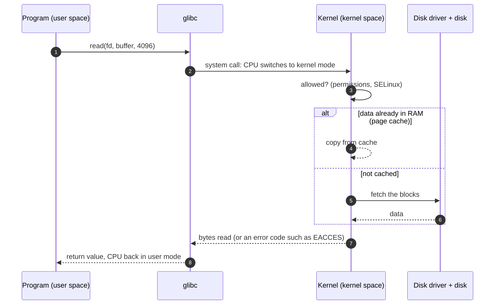

# 001 · What Is Linux?

> **You need first:** nothing. This is the starting point.
> **Next:** [002 · Build your practice lab](002-build-your-practice-lab.md)

---

## What it is

A computer is a box of hardware. On its own, hardware can't do anything useful. It needs software to tell it what to do.

Some basic hardware words you will see everywhere:

- **CPU** (Central Processing Unit) is the chip that runs instructions. It is the "brain". A CPU has several **cores**, and each core can run one thing at a time.
- **RAM** (Random Access Memory) is fast, temporary memory. Programs and data sit here while they run. It is wiped when power goes off.
- **Disk** (an HDD, Hard Disk Drive, or an SSD, Solid State Drive) is slow, permanent storage. Files stay here after power-off.
- **NIC** (Network Interface Card) is the part that connects the computer to a network (a cable or Wi-Fi).
- **Firmware** is the small program built into the motherboard that runs first when you press the power button. On modern machines it is called **UEFI** (Unified Extensible Firmware Interface). On older machines it is called **BIOS** (Basic Input/Output System).

An **operating system (OS)** is the software layer that sits between the hardware and your programs. It shares the hardware between many programs safely. Windows, macOS and Linux are operating systems.

**Linux** is, strictly speaking, a **kernel**. The kernel is the core of the OS: the one program that talks directly to the hardware. Everything else (the command line, tools, web servers, databases) runs on top of it.

A **Linux distribution** ("distro") is the kernel plus thousands of other programs, packaged together so you can install and use it. RHEL, Ubuntu and Debian are distributions.

## Why it exists

Without an OS, every program would need its own code to drive the disk, the network card and the screen. Two programs could also overwrite each other's memory. The kernel solves this:

- It **shares** the CPU, RAM, disk and network between many programs.
- It **isolates** programs, so one program can't read or break another's memory.
- It **hides hardware details**. A program says "write this to a file", and the kernel works out which disk, which sector and which driver.
- It **enforces security**: who may read which file, who may open which network port.

Linux became the standard for servers because it is free, open source (anyone can read and change the code), stable, and runs on everything from phones to supercomputers. Almost every cloud server, every container and every Kubernetes node runs Linux.

## Analogy

Think of a **restaurant**.

- The **hardware** is the kitchen: stoves, fridges, knives.
- The **kernel** is the head chef. Only the chef touches the stoves directly. The chef decides who cooks when and makes sure two cooks don't grab the same pan.
- **Programs** are waiters. A waiter never walks into the kitchen and cooks. They hand an order slip through a window.
- That window is a **system call**: the only official way to ask the kernel to do something.
- The **distribution** is the whole restaurant: kitchen, chef, waiters, menu and decor, ready to open.

## How it works inside

### Two worlds: kernel space and user space

The CPU has a hardware "privilege switch". Code runs in one of two modes:

| Mode | Who runs there | What it can do |
|---|---|---|
| **Kernel space** (privileged mode) | Only the kernel | Touch any hardware, any memory |
| **User space** (restricted mode) | Every normal program: the shell, `ls`, nginx, Python, databases | Only its own memory. Must ask the kernel for everything else |

```
 ┌──────────────────────────────────────────────┐
 │ Applications (dnf, sshd, nginx, vim, python) │  user space
 │ Shell (bash) + small tools (ls, cp, grep)    │
 │ System library (glibc)                       │
 ├─────────────── system calls ─────────────────┤  ← the "order window"
 │ Kernel: scheduler, memory manager,           │  kernel space
 │ filesystems, networking, device drivers,     │
 │ security (SELinux), cgroups and namespaces   │
 ├──────────────────────────────────────────────┤
 │ Hardware: CPU, RAM, disk, NIC                │
 └──────────────────────────────────────────────┘
```

### What happens when a program wants to read a file

1. The program calls a function in **glibc** (the GNU C Library). glibc is a shared library that almost every program uses. It wraps kernel requests in friendly functions.
2. glibc puts a **system call** number (for example, "read") and its arguments into CPU registers. It then runs a special instruction that switches the CPU into kernel mode.
3. The kernel checks: is this program allowed to read this file? Is the file already in RAM (cached)? If not, it tells the disk driver to fetch it.
4. The kernel copies the data into the program's memory, switches back to user mode and returns a result.
5. If anything fails, the kernel returns an error code (for example, "permission denied") instead of data.



That's why, in production, a tool called `strace` (which shows every system call a program makes) is so powerful. It shows you exactly where a program is stuck talking to the kernel. You'll use it in topic 092.

### The kernel's main jobs

| Part of the kernel | Job |
|---|---|
| **Scheduler** | Decides which program runs on which CPU core, and for how long (thousands of switches per second) |
| **Memory manager** | Gives each program its own private memory and moves data between RAM and disk |
| **VFS** (Virtual File System) and filesystem drivers | One common way to access files on any kind of disk or network share |
| **Network stack** | Sends and receives network packets (TCP/IP) |
| **Device drivers** | Code that knows how to talk to a specific piece of hardware |
| **Security** | File permissions, SELinux, capabilities |
| **cgroups and namespaces** | Limit and isolate groups of programs. These are the foundation of containers and Kubernetes |

**Monolithic but modular:** Linux is a *monolithic* kernel. Drivers run inside the kernel, which is fast, but a bad driver can crash the whole machine. It is also *modular*: drivers can be loaded and unloaded while the system runs (topic 055). The opposite design, a *microkernel*, runs drivers as separate user-space programs.

### "Everything is a file"

Linux shows many things as files: real files, folders, disks (`/dev/sda`), terminals (`/dev/pts/0`), and even kernel settings (`/proc/sys/...`). One set of tools (`cat`, `echo`, `ls`) can work with all of them. You'll see this idea again and again.

### A very short history (why things look the way they do)

| Year | Event |
|---|---|
| 1969 | Ken Thompson and Dennis Ritchie at Bell Labs create **UNIX**, written in assembly (low-level machine-specific code) |
| 1973 | UNIX is rewritten in the **C** language. Now it can be moved to other hardware (it is "portable") |
| 1983 | Richard Stallman starts the **GNU** project ("GNU's Not Unix"): free versions of the compiler (GCC), C library (glibc), shell (bash) and core tools (coreutils) |
| 1985 | The **FSF** (Free Software Foundation) is founded |
| 1988 | **POSIX** (Portable Operating System Interface) standardises how UNIX-like systems behave |
| 1991 | Linus Torvalds, a Finnish student, writes the **Linux** kernel from scratch and publishes it |
| 1992 | Linux is licensed under the **GPLv2** (GNU General Public License, version 2) |
| 1993–94 | Debian and Slackware appear; Linux 1.0; the first Red Hat Linux |
| 2002–03 | **RHEL** (Red Hat Enterprise Linux) and **Fedora** appear |
| 2013–14 | **Docker** and **Kubernetes** appear, built on Linux namespaces and cgroups |
| 2019–21 | IBM buys Red Hat; **CentOS Stream** replaces CentOS Linux; **Rocky Linux** and **AlmaLinux** appear |
| 2025 | **RHEL 10** is released (20 May 2025) |

**Is Linux UNIX?** No. Linux is **UNIX-like**. It copies UNIX's design and follows POSIX, but it contains no UNIX code and isn't certified as "UNIX" (a trademark). macOS, AIX and Solaris are certified UNIX.

**Licensing in one paragraph:** the kernel is under GPLv2 only. "Copyleft" means that if you distribute a changed version, you must share its source code under the same licence. A distribution mixes many licences (GPL, LGPL, MIT, BSD, Apache). "Free software" means free as in freedom (run, study, change, share), not free as in price. "Open source" (a 1998 term) means largely the same licences, with a focus on the development model.

### Distributions: the families you'll meet

| Family | Distributions | Package format and tool |
|---|---|---|
| **Red Hat** | **Fedora** (fast-moving, newest features) → **CentOS Stream** (a preview of the next RHEL minor release) → **RHEL** (paid, supported 10 years). Free rebuilds that match RHEL: **Rocky Linux**, **AlmaLinux** | RPM files, `dnf` tool |
| **Debian** | **Debian**, **Ubuntu** (very common in cloud and DevOps), Kali | DEB files, `apt` tool |
| **SUSE** | SLES, openSUSE | RPM files, `zypper` tool |
| Others | Arch (`pacman`), Alpine (very small, common in container images; uses `apk`) | — |

These notes use **RHEL 10** as the main system and point out where **Ubuntu/Debian** differ. Most Linux knowledge (the kernel, shell, processes, networking) is the same on all of them. The differences are mostly in package tools, network config tools and security modules.

### RHEL 10 facts worth knowing

| Area | RHEL 10 |
|---|---|
| Kernel | 6.12 |
| Support lifecycle | Until 2035 |
| CPU requirement | **x86-64-v3**: an x86 CPU level that includes the AVX2 (Advanced Vector Extensions 2) instructions. Roughly Intel Haswell (2013) or newer. Older CPUs can't boot it |
| 32-bit software | Removed |
| Network config | NetworkManager "keyfiles" only. The old `ifcfg` files and the `dhclient` tool are removed |
| Network teaming | Removed. Use bonding (topic 062) |
| Graphics | Xorg server removed. Wayland only |
| Desktop apps | Firefox and similar moved to Flatpak (topic 032) |
| Root account | The installer disables the root password by default. You use an admin user with `sudo` (topic 028) |
| cgroups | Only version 2 (cgroups v1 removed) |
| `/usr/sbin` | Still a separate directory (Fedora merged it into `/usr/bin`; RHEL 10 did not) |
| SSH keys | `ssh-keygen` makes Ed25519 keys by default |
| Upgrade path | In-place upgrade from RHEL 9.6 with the **Leapp** tool, or a fresh install |

## Commands

You can't run these until you have a lab (next topic). Read them now and come back to try them.

```bash
uname -r
```
```
6.12.0-211.53.1.el10_2.x86_64
```
- `uname` prints system information. `-r` asks for the kernel **release**.
- `6.12.0` is the upstream kernel version. `211.53.1` is the distribution's build number. `el10_2` means "Enterprise Linux 10, update 2". `x86_64` is the CPU architecture (64-bit Intel/AMD).

```bash
uname -m
```
```
x86_64
```
- `-m` means **machine** (the architecture). You'd see `aarch64` on 64-bit ARM machines (AWS Graviton, Apple Silicon VMs).

```bash
cat /etc/os-release
```
```
NAME="AlmaLinux"
VERSION="10.2 (Lavender Lion)"
RELEASE_TYPE=stable
ID="almalinux"
ID_LIKE="rhel centos fedora"
VERSION_ID="10.2"
PLATFORM_ID="platform:el10"
PRETTY_NAME="AlmaLinux 10.2 (Lavender Lion)"
...
```
- `cat` prints a file. `/etc/os-release` exists on **every** modern distro (Ubuntu too). Scripts read it to know where they are running.
- `ID` is the short name (`rhel`, `almalinux`, `ubuntu`, `debian`).
- `ID_LIKE` lists the families it is compatible with: AlmaLinux says it behaves like `rhel`.
- `VERSION_ID` is the version number. `PLATFORM_ID="platform:el10"` is the same on RHEL 10 and every rebuild of it. On real RHEL you'd see `NAME="Red Hat Enterprise Linux"` and `ID="rhel"`.

```bash
cat /etc/redhat-release        # RHEL family only
```
```
AlmaLinux release 10.2 (Lavender Lion)
```
- RHEL-family systems keep this one-line file for older scripts. RHEL itself prints `Red Hat Enterprise Linux release 10.x (…)`.

```bash
hostnamectl
```
```
     Static hostname: localhost
           Icon name: computer-vm
             Chassis: vm 🖴
          Machine ID: 70f12486803644139ed48fe11bab52f7
             Boot ID: d67267e2d11d43d2b3345e154bd3356c
      Virtualization: oracle
    Operating System: AlmaLinux 10.2 (Lavender Lion)
         CPE OS Name: cpe:/o:almalinux:almalinux:10.2
      OS Support End: Fri 2035-06-01
              Kernel: Linux 6.12.0-211.53.1.el10_2.x86_64
        Architecture: x86-64
     Hardware Vendor: innotek GmbH
      Hardware Model: VirtualBox
...
```
- A one-screen summary. `Virtualization: oracle` means this is a virtual machine running in VirtualBox (Oracle's hypervisor; you'll learn these words in topic 002). On KVM it says `kvm`; on real hardware the line is missing.
- `Static hostname: localhost` means nobody has set a hostname yet (topic 060 shows how).

```bash
ldd /usr/bin/ls
```
```
	linux-vdso.so.1 (0x00007f62283b8000)
	libselinux.so.1 => /lib64/libselinux.so.1 (0x00007f6228355000)
	libcap.so.2 => /lib64/libcap.so.2 (0x00007f6228348000)
	libc.so.6 => /lib64/libc.so.6 (0x00007f622816e000)
	libpcre2-8.so.0 => /lib64/libpcre2-8.so.0 (0x00007f62280ce000)
	/lib64/ld-linux-x86-64.so.2 (0x00007f62283ba000)
```
- `ldd` lists the **shared libraries** a program needs. A shared library is code that many programs load instead of each carrying its own copy.
- `libc.so.6` is glibc, the wrapper around system calls.
- `ld-linux-x86-64.so.2` is the **dynamic loader**: it finds and loads the libraries when the program starts.
- The hex numbers are memory addresses where each library was loaded. They change on every run, for security.

```bash
grep -o -m1 avx2 /proc/cpuinfo
```
```
avx2
```
- Checks whether the CPU supports AVX2, which RHEL 10 needs. `/proc/cpuinfo` is a "file" the kernel creates on the fly with CPU details. No output means no AVX2, so RHEL 10 won't run.

### Try it
1. After building your lab (topic 002), run `uname -r`, `cat /etc/os-release` and `hostnamectl`. Write down your kernel version and distro ID.
2. Run `ldd /usr/bin/bash`. Find glibc in the list.
3. If you also have an Ubuntu machine or container, compare its `/etc/os-release`.

**Check your work:** on your lab VM, from the notes folder, run `sudo ./checks/check 001` for every step, or `sudo ./checks/check 001 STEP` for one (topic 002 shows how to get the notes there).

## Where you'll use it

- **First command on any unknown server:** `cat /etc/os-release; uname -r`. It tells you which package tool, config paths and known bugs apply.
- **Bug reports and security advisories** list affected kernel versions. You'll compare them with `uname -r`.
- **Container images** are distros too (UBI, which is Red Hat's Universal Base Image, or Ubuntu, Alpine). Knowing the family tells you whether to use `dnf`, `apt` or `apk`.
- **Kubernetes nodes** report their kernel and OS image. Container features depend on the kernel version.
- **Interviews:** "kernel vs OS", "what is a system call" and "user vs kernel space" are standard openers.

## When it breaks

| Symptom | What's going on | What to do |
|---|---|---|
| RHEL 10 installer or VM stops very early, mentioning the CPU or "x86-64-v3" | The CPU (or the virtual CPU the hypervisor shows) lacks AVX2 | Use a newer host CPU. On KVM, set the CPU mode to `host-passthrough`. On Windows with Hyper-V active, VirtualBox may hide AVX2 |
| A program says `error while loading shared libraries: libX.so.N: cannot open shared object file` | A required shared library is missing or the wrong version | `ldd /path/to/program` shows which `=> not found`. Install the package that provides it (topic 031) |
| A program built for one distro doesn't run on another | Different glibc or library versions | Use the distro's own package, or ship it as a container |
| `uname -r` shows an old kernel after an update | The new kernel is installed but you haven't rebooted | Reboot (kernels only change at boot) |

## Quick recap

- The **kernel** controls the hardware. **User space** programs ask it for everything through **system calls**.
- **Linux** is a UNIX-like kernel (1991, GPLv2). A **distribution** = kernel + GNU tools + other software + an installer.
- The Red Hat family uses RPM and `dnf`. The Debian/Ubuntu family uses DEB and `apt`. The core Linux skills are the same.
- Identify any system with `cat /etc/os-release` and `uname -r`.

**Interview questions**

1. *Is Linux an operating system?* Strictly it is a kernel. A usable OS is the kernel plus user-space tools (mostly GNU) and applications, packaged as a distribution.
2. *What is a system call?* The controlled entry point from a user program into the kernel, like `open()`, `read()` or `fork()`. It is the only way a program can touch hardware or other protected resources.
3. *Monolithic vs microkernel?* A monolithic kernel runs drivers inside the kernel (fast, but a driver bug can crash everything). A microkernel runs them as separate user-space programs (isolated, but slower). Linux is monolithic but loads drivers as modules.

**Scenario question** (answer out loud first, then compare)

> *"You're handed SSH access to a server nobody has documented. In the first two minutes, how do you find out what it is?"*

**Model answer:**
1. `cat /etc/os-release`: the distribution and version (RHEL 10.2, Ubuntu 24.04…). This decides `dnf` vs `apt`, `firewalld` vs `ufw`, SELinux vs AppArmor.
2. `uname -r`: the running kernel. If it differs from the newest installed one (`rpm -q kernel`), a reboot is pending.
3. `hostnamectl`: the hostname, whether it's a VM (and which hypervisor), the architecture and firmware.
4. `uptime` and `who`: how long it has been up, its load, and who else is logged in.
5. Only then start changing things, knowing which family's tools and paths apply.

**Likely follow-ups:**
- *Why does knowing the distribution matter so much?* Package tools, config file locations, the firewall and the security module all differ between families. The kernel and shell skills don't.
- *What's in user space and what's in the kernel?* The kernel: scheduler, memory, filesystems, network stack, drivers. Everything else (shell, sshd, databases) is in user space and asks the kernel through system calls.
