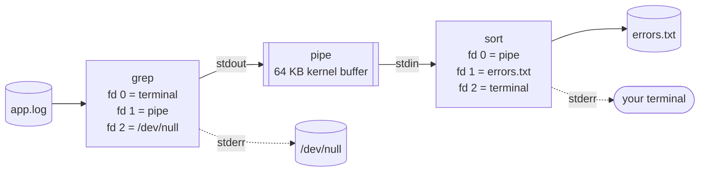

# 016 · Redirection, Pipes and Creating Files

> **You need first:** [015 · Command history](015-command-history.md)
> **Next:** [017 · grep and regular expressions](017-grep-and-regular-expressions.md)

---

## What it is

Every running program has numbered "connections" for input and output. These are called **file descriptors** (FDs). Three are always open:

| FD | Name | Short for | Normally connected to |
|---|---|---|---|
| 0 | **stdin** | standard input | Your keyboard |
| 1 | **stdout** | standard output | Your terminal screen |
| 2 | **stderr** | standard error | Your terminal screen (separate channel, for error messages) |

- **Redirection** reconnects these to files instead: `>` sends stdout to a file, `2>` sends stderr, `<` reads stdin from a file.
- A **pipe** (`|`) connects one program's stdout straight into the next program's stdin.
- **`/dev/null`** is a special device file that throws away everything written to it, like a black hole.
- A **heredoc** (`<<EOF`) feeds several lines of text as input. It's the cleanest way to create a config file in one command.
- **`tee`** copies its input both to the screen and to a file.

## Why it exists

This is the UNIX philosophy: **small tools that each do one job, joined by pipes**. Instead of one giant program that "finds the top 5 IP addresses with errors", you chain `grep | cut | sort | uniq -c | sort -rn | head -5`.

Keeping errors (stderr) separate from normal output (stdout) means you can save clean data to a file while errors still show on screen, or log errors separately.

## Analogy

A program is a **kitchen appliance with three hoses**: one **water inlet** (stdin), one **outlet for the product** (stdout) and one **drain for waste** (stderr). Normally the inlet is your keyboard and both outlets spray onto your screen.
- `>` connects the product outlet to a bucket (a file).
- `2>` connects the waste drain to a different bucket.
- `|` connects one machine's outlet directly to the next machine's inlet, forming a production line.
- `/dev/null` is a drain to nowhere.

## How it works inside

### The shell wires things up before the program starts

When you type `ls /etc > list.txt`:
1. bash creates a child process (fork).
2. **In the child**, bash opens `list.txt` for writing. **This truncates the file to 0 bytes immediately.**
3. bash makes FD 1 point to that file (a system call named `dup2`).
4. The child becomes `ls` (execve). `ls` just writes to FD 1 as usual. It has no idea it's writing to a file and never sees the `>`.

Two important consequences:
- **Truncation happens before the command runs.** `sort data.txt > data.txt` empties `data.txt` before `sort` can read it, so you lose the data. Even a failing command (`fakecmd > file`) empties the file.
- Redirections are processed **left to right**, which is why order matters (below).

### How a pipe works

For `cmd1 | cmd2`, bash asks the kernel for a **pipe**: an in-memory buffer (64 KB by default on Linux) with a write end and a read end. It starts **both** programs **at the same time**. cmd1's stdout goes to the write end; cmd2's stdin reads from the read end.
- Data streams through. No temporary file is written.
- If cmd2 reads slowly, the buffer fills and cmd1 is **paused** until there's room (back-pressure).
- If cmd2 exits early (like `head -1`), cmd1 gets a "broken pipe" signal (SIGPIPE) the next time it writes, and stops. That's why `yes | head -1` finishes instantly.
- A pipe carries **only stdout**. stderr still goes to your screen unless you redirect it.
- The pipeline's exit status is that of the **last** command, unless `set -o pipefail` is on (topic 014).

What `grep error app.log 2>/dev/null | sort > errors.txt` looks like after bash has wired it up:



Both programs run at the same time. Neither knows where its fds point; bash set that up before each one started.

### Order of `2>&1`

`2>&1` means "make FD 2 point **where FD 1 points right now**".

```bash
cmd > out.txt 2>&1    # 1→out.txt, then 2→(where 1 points)=out.txt   ✔ both go to the file
cmd 2>&1 > out.txt    # 2→screen (where 1 points now), then 1→out.txt ✘ errors still on screen
```

## Commands

### Operators

| Operator | Effect | Example |
|---|---|---|
| `> file` | stdout → file (**truncate first**) | `ls /etc > list.txt` |
| `>> file` | stdout → file (append) | `echo line >> notes.txt` |
| `2> file` / `2>> file` | stderr → file / append | `find / -name x 2> err.log` |
| `> file 2>&1` | stdout **and** stderr → file | `cmd > all.log 2>&1` |
| `&> file` / `&>> file` | Same, bash shorthand | `ping -c1 host &> net.log` |
| `>&2` | stdout → stderr (for script error messages) | `echo "ERROR" >&2` |
| `2>/dev/null` | Throw away errors | `find / -name passwd 2>/dev/null` |
| `>/dev/null 2>&1` | Throw away everything | `cmd >/dev/null 2>&1` |
| `< file` | stdin ← file | `tr a-z A-Z < f` |
| `<< DELIM` | Heredoc: several lines as stdin | below |
| `<<< "text"` | Here-string: one string as stdin | `grep Linux <<< "I love Linux"` |
| `>\| file` | Overwrite even when `noclobber` is on | |
| `cmd1 \| cmd2` | Pipe stdout | `ls -l \| less` |
| `cmd1 \|& cmd2` | Pipe stdout **and** stderr (= `2>&1 \|`) | `make \|& tee build.log` |

### Seeing stdout and stderr separately

```bash
ls /etc/hostname /nope
```
```
ls: cannot access '/nope': No such file or directory
/etc/hostname
```

```bash
ls /etc/hostname /nope > out.txt
```
```
ls: cannot access '/nope': No such file or directory
```
- Only stdout went to the file; the error (stderr) still appeared.

```bash
ls /etc/hostname /nope > out.txt 2> err.txt ; cat out.txt err.txt
```
```
/etc/hostname
ls: cannot access '/nope': No such file or directory
```

```bash
find / -name sshd_config 2>/dev/null
```
```
/etc/ssh/sshd_config
```
- Without `2>/dev/null`, hundreds of "Permission denied" lines would bury the answer.

### The truncation trap

```bash
printf 'b\na\nc\n' > data.txt
sort data.txt > data.txt ; cat data.txt     # prints nothing: the file was emptied first
printf 'b\na\nc\n' > data.txt
sort data.txt -o data.txt ; cat data.txt    # ✔ sort's own -o option is safe
```
```
a
b
c
```

Protect yourself in interactive shells with `set -o noclobber`: then `>` refuses to overwrite existing files (`>|` forces it).

### Pipes and tee

```bash
ls -l /etc | tee listing.txt | wc -l
```
```
176
```
- `tee` wrote the listing to `listing.txt` **and** passed it on to `wc -l`.

```bash
sudo dnf -y update 2>&1 | tee -a /root/update.log
```
- Watch progress live **and** keep a log. `-a` appends.

```bash
rm ghost.txt | grep ghost       # grep sees nothing: the error went to stderr
rm ghost.txt 2>&1 | grep ghost
```
```
rm: cannot remove 'ghost.txt': No such file or directory
```

### Input redirection

```bash
wc -l /etc/passwd ; wc -l < /etc/passwd
```
```
27 /etc/passwd
27
```
- With `<`, **the shell** opens the file and `wc` only sees a stream, so it can't print a name. Handy in scripts when you want just the number.

```bash
tr 'a-z' 'A-Z' < /etc/hostname
```
```
SERVER1.EXAMPLE.COM
```
- `tr` only reads from stdin, so it needs `<` or a pipe.

### Creating files without an editor

```bash
echo "Hello" > greeting.txt          # create / overwrite
echo "World" >> greeting.txt         # append
printf '%s\n' line1 line2 > two.txt  # several lines, predictable
cat > notes.txt                      # type lines, then Ctrl+D to finish
```

**Heredoc**, the best way to write a config file in one go:

```bash
cat > /tmp/app.conf <<'EOF'
# app configuration
port=8080
log_dir=/var/log/app
user=$USER          # stays literally "$USER" because 'EOF' is quoted
EOF
```
- Everything between the `<<'EOF'` line and the line containing only `EOF` becomes the input.
- **Quoted** delimiter (`'EOF'`): text is written exactly as typed. No `$var` or `$(cmd)` replacement.
- **Unquoted** delimiter (`EOF`): variables and commands are replaced, which is useful for templates.
- `<<-EOF` strips leading **tab** characters (not spaces), so you can indent a heredoc inside a script.
- The closing `EOF` must be **alone on its line**, with no spaces before or after.

### Writing a root-owned file: the `sudo` trap

```bash
sudo echo "10.0.0.5 web1" >> /etc/hosts
```
```
-bash: /etc/hosts: Permission denied
```
- `sudo` only runs `echo` as root. The `>>` redirection is done by **your own shell**, as your normal user, before sudo starts.

```bash
echo "10.0.0.5 web1" | sudo tee -a /etc/hosts
```
```
10.0.0.5 web1
```
- ✔ `tee` runs as root, so it can open the file. `-a` appends. Add `>/dev/null` to hide the echo.

```bash
sudo tee /etc/motd >/dev/null <<'EOF'
Authorised use only. Activity is logged.
EOF
```
- Heredoc + `sudo tee` = write a multi-line root-owned file.

### Emptying a file

```bash
> app.log              # truncate to 0 bytes
truncate -s 0 app.log  # same
```
**Truncate, don't delete, a log that a running program has open.** `rm` only removes the name. The program keeps writing to the deleted file, and the disk space isn't freed until it restarts (topic 008).

### Try it
1. `ls /etc /nope > a.txt 2>&1` vs `ls /etc /nope 2>&1 > b.txt`. Compare the files and what you saw.
2. Write a 3-line config with a quoted heredoc that contains `$HOME`. Then write it again with an unquoted heredoc. Compare.
3. Run `sudo echo test > /etc/test1` and see it fail. Then do it correctly with `tee`.
4. `set -o noclobber; echo x > a.txt` → error; `echo x >| a.txt` → works; `set +o noclobber`.

**Check your work:** on your lab VM, from the notes folder, run `sudo ./checks/check 016` for every step, or `sudo ./checks/check 016 STEP` for one (topic 002 shows how to get the notes there).

## Where you'll use it

- **cron jobs:** `/usr/local/bin/backup.sh >> /var/log/backup.log 2>&1`. Without `2>&1`, errors go to email (or nowhere) and you never see them (topic 039).
- **Scripts:** error messages go to stderr with `echo "ERROR: …" >&2`, so callers can separate them from data.
- **Containers:** Docker and Kubernetes capture a container's **stdout and stderr** as its logs. Apps in containers should log to stdout/stderr, not to files.
- **Writing configs in automation:** heredoc + `sudo tee`, or in Dockerfiles/cloud-init (topic 104).
- **Log pipelines:** `journalctl -u app | grep ERROR | tail -20` (topic 038).

## When it breaks

| Symptom | Cause | Fix |
|---|---|---|
| Errors still print after `> file` | They're on stderr | Add `2>&1` **after** `> file`, or `2> err.log` |
| `2>&1 > file` doesn't capture errors | Wrong order | `> file 2>&1` |
| Output file is empty | `>` truncated it before the command ran (same file as input, or the command failed) | Write to a temp file, then `mv`; or use `sort -o` |
| `cannot overwrite existing file` | `noclobber` is on | `>\|`, or `set +C` |
| `Permission denied` with `sudo cmd > /etc/x` | Your shell, not sudo, does the redirection | `cmd \| sudo tee /etc/x` |
| `grep` after a pipe doesn't see error messages | Pipes carry stdout only | `2>&1 \|` or `\|&` |
| Disk still full after `rm` of a big log | The program still has the file open | Truncate instead; `lsof +L1`; restart the program |
| Heredoc never ends, shell shows `>` | The closing `EOF` has spaces or is indented | Put `EOF` alone at the start of the line |

## Quick recap

- FD 0 stdin, 1 stdout, 2 stderr. The **shell** sets up redirections before the program runs.
- `>` truncates immediately; `>>` appends; `> f 2>&1` captures both (order matters); `2>/dev/null` hides errors.
- Pipes run all commands at once and carry stdout only. `tee` splits a stream; `| sudo tee` writes root-owned files.
- Heredoc with `<<'EOF'` writes literal multi-line files.

**Interview questions**

1. *What's the difference between `cmd > f 2>&1` and `cmd 2>&1 > f`?* The first sends both stdout and stderr to `f`. The second points stderr at the terminal (where stdout pointed at that moment), then moves only stdout to `f`.
2. *Why does `sudo echo x > /etc/file` fail?* The redirection is done by your own non-root shell before sudo runs. Use `echo x | sudo tee /etc/file`.
3. *Why does `sort f > f` destroy the file?* The shell truncates `f` to zero bytes before `sort` starts reading it.

**Scenario question** (answer out loud first, then compare)

> *"A nightly job's log file is always empty, even when the job clearly failed. The cron line is `backup.sh 2>&1 > /var/log/backup.log`. What's wrong?"*

**Model answer:**
1. Redirections are processed **left to right**. `2>&1` points stderr at where stdout points **now** (cron's mail/output pipe). Then `> file` moves only stdout to the file.
2. The errors (stderr) never reach the file, and a failing backup writes mostly errors.
3. Fix: `backup.sh > /var/log/backup.log 2>&1` (or `>>` to keep history).
4. Also make the job's exit status visible: alert on non-zero, or run it as a systemd service so failures show in `systemctl --failed`.

**Likely follow-ups:**
- *How do you write to a root-owned file from a non-root shell with sudo?* `cmd | sudo tee /etc/file` (or `tee -a`), because `sudo cmd > file` opens the file with your own permissions.
- *What happens to `cmd1 | head -1` when cmd1 keeps writing?* It gets SIGPIPE on its next write after `head` exits, and stops.
