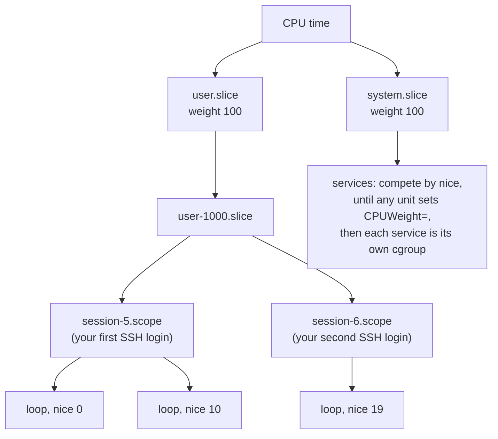

# 035 · Process Priority: nice, renice and Friends

> **You need first:** [034 · top and load average](034-top-and-load-average.md)
> **Next:** [036 · Resource monitoring](036-resource-monitoring.md)

---

## What it is

The **scheduler** is the part of the kernel that decides which process runs on which CPU, and for how long. When more processes want CPU time than there are cores, it has to share. For normal processes you influence the sharing with the **nice value**:

- Range **−20** (highest priority, least "nice" to others) to **+19** (lowest priority, very "nice").
- Default **0**.
- Higher nice = a **smaller share** of CPU when the CPUs are busy.

Tools: `nice` (start a command with a nice value), `renice` (change a running process), plus related tools for disk I/O priority (`ionice`), CPU pinning (`taskset`) and real-time scheduling (`chrt`).

## Why it exists

Some work matters more than other work. A nightly backup compressing 200 GB shouldn't slow down the web server answering customers. Nice lets the backup use **spare** CPU without competing equally with important processes.

Nice does **nothing** when the CPUs are idle, and it does **not** affect disk I/O.

## Analogy

The CPU is a **shared pizza**. Each process gets slices according to its **weight**. Nice is how polite you are: a nice value of +19 means "I'll take a tiny slice, others first"; −20 means "give me a big slice". If nobody else is hungry (idle CPUs), even the most polite person can eat the whole pizza.

## How it works inside

- Linux 6.6+ (including RHEL 10's 6.12) uses the **EEVDF** scheduler ("Earliest Eligible Virtual Deadline First"), which replaced the older **CFS** ("Completely Fair Scheduler"). From an admin's point of view, nice works the same in both.
- Each nice value maps to a **weight**: nice 0 = 1024, and each step changes it by about **1.25×** (nice 10 = 110, nice 19 = 15). Your share is your weight divided by the total weight of everything competing. Shares are **relative**: two processes at nice 10 split the CPU 50/50, exactly like two at nice 0.
- top's `PR` column = `20 + NI` for normal tasks (0…39). Real-time tasks show a **negative** PR (`-1 - priority`, so `chrt -f 50` shows `-51`), and priority 99 shows as `rt`. Real-time tasks always run before normal ones.
- Nice is stored per process (actually per thread) and **inherited** by child processes. It disappears when the process ends, so to make it permanent for a service, set it in the systemd unit (topic 098). See the cgroup section below for which setting to use.

### Scheduling policies

Nice only applies to the normal policy. Every thread has a **policy**; `chrt` shows and changes it, and `ps -o cls` shows it as a short code:

| Policy | `ps` CLS | What it's for |
|---|---|---|
| `SCHED_OTHER` (normal) | `TS` | Everything by default. Shares CPU by weight (nice) |
| `SCHED_BATCH` | `B` | CPU-heavy batch work; treated like normal but preempts others less often |
| `SCHED_IDLE` | `IDL` | Runs only when nothing else wants the CPU: even weaker than nice 19 |
| `SCHED_FIFO` | `FF` | **Real-time**, priority 1–99. Runs until it blocks or a higher real-time task appears |
| `SCHED_RR` | `RR` | Real-time like FIFO, but tasks of equal priority take turns (time slices) |
| `SCHED_DEADLINE` | `DLN` | Real-time with a runtime/period budget, for specialised workloads |

**Real-time throttling:** by default the kernel reserves a little CPU for normal tasks (`kernel.sched_rt_runtime_us = 950000` of every `sched_rt_period_us = 1000000`). On the lab VM, a busy `SCHED_FIFO` loop took **94.7%** of the CPU and a normal loop got **4.3%**: the machine stays barely usable, but everything else crawls. Real-time is for short, latency-critical work (audio, industrial control), never for "make my batch job faster".

### Nice only works inside one cgroup

This is the part most guides miss. On a systemd host, the CPU is shared **level by level through cgroups** (topic 097) first, and nice only decides between tasks **in the same cgroup**:



Measured on the lab VM (one CPU, all loops pinned to it):

| Experiment | Result | Why |
|---|---|---|
| Three loops started from **one shell**: nice 0, nice 0, nice 10 | 46% / 46% / **5%** | Same cgroup: nice decides (weights 1024 : 1024 : 110) |
| One loop at nice 0 in one SSH session, one at **nice 19** in another | **49% / 49%** | Each login is its own cgroup (`session-N.scope`) with equal weight; nice is ignored between them |
| Two services, one with `Nice=19` | 97% / **1%** | RHEL leaves the CPU controller off inside `system.slice`, so services compete as plain tasks |
| The same two services while **any** unit uses `CPUWeight=` | **49% / 49%** | systemd switched the CPU controller on for `system.slice`; now each service is a cgroup and `Nice=` no longer ranks them |
| Two services with `CPUWeight=1000` and the default 100 | 90% / 10% | The cgroup weight decides |

So:
- To lower the priority of **your own command** relative to your other work, nice works.
- To rank **services**, use **`CPUWeight=`** (or a hard cap, `CPUQuota=`) in the unit, or `systemctl set-property app CPUWeight=500`. `Nice=` only works by accident of the current cgroup layout.
- `kernel.sched_autogroup_enabled` is `1` on RHEL 10, but autogrouping only applies to tasks in the **root** cgroup, which on a systemd host is almost nothing. cgroups do the grouping.

### CPU affinity

`taskset` (and systemd's `CPUAffinity=`, or a cgroup's `cpuset.cpus`) limits **which** CPUs a task may run on. It's for special cases: keeping a latency-critical process on dedicated cores, or a licence tied to core count. Pinning things by hand usually makes performance worse, because the scheduler can no longer balance load.

### Disk priority: ionice

`ionice` sets an **I/O class** (1 real-time, 2 best-effort with levels 0–7, 3 idle). It only works if the disk's **I/O scheduler** (topic 094) honours it. Two writers on the lab VM, one with `ionice -c3`, for 10 seconds each:

| Scheduler | Normal writer | Idle-class writer | Effect |
|---|---|---|---|
| `bfq` | 4114 MB | 1306 MB | Strong |
| `mq-deadline` (RHEL default for SATA/virtio) | 795 MB | 497 MB | Partial |
| `none` (the usual NVMe default) | 2607 MB | 2366 MB | **None** |

On NVMe or anything using `none`, limit I/O with the cgroup instead: `IOReadBandwidthMax=` / `IOWriteBandwidthMax=` / `IOWriteIOPSMax=` in the unit (topic 098).

### Who may do what

| Action | Normal user | root |
|---|---|---|
| Start a command with nice > 0 | ✔ | ✔ |
| Raise the nice value of your own process (lower its priority) | ✔ | ✔ |
| **Lower** the nice value, even back to where it was | ✘ | ✔ |
| Use negative nice values | ✘ | ✔ |
| Renice other users' processes | ✘ | ✔ |

(PAM's `limits.conf` can allow specific users to go lower, with the `nice` item, topic 029.)

## Commands

```bash
nice -n 10 tar -czf /backup/home.tgz /home
```
- Starts tar at nice 10. `nice cmd` with no `-n` means 10.

```bash
sudo nice -n -5 ./critical_job
```
- Negative values need root.

```bash
renice -n 15 -p 4410
```
```
4410 (process ID) old priority 0, new priority 15
```

```bash
sudo renice -n 10 -u alice     # every process of alice
renice -n 15 -g 4321           # a whole process group
```

```bash
ps -eo pid,ni,pri,%cpu,cmd --sort=-%cpu | head -5
```
```
    PID  NI PRI %CPU CMD
   4410  15   4 48.2 tar -czf /backup/home.tgz /home
   1234   0  19 31.0 /usr/bin/java -jar app.jar
```
- `NI` = nice. (`ps`'s `PRI` column uses a different scale than top's `PR`; compare NI.)

In `top`: press `r`, type the PID, then the new nice value.

### Seeing the effect (on one CPU)

```bash
taskset -c 0 sh -c 'while :; do :; done' &
taskset -c 0 sh -c 'while :; do :; done' &
taskset -c 0 nice -n 10 sh -c 'while :; do :; done' &
top          # press 1: the two nice-0 loops get ~46% each, the nice-10 one ~5%
pkill -f '^sh -c while'
```
- `taskset -c 0` pins all three to CPU 0, so they must compete.
- The `pkill` pattern is anchored with `^` on purpose: an unanchored `pkill -f 'while :'` also matches any shell or SSH command line that contains that text, including the one you're typing it in.

Real output on the lab VM:
```
    PID USER      PR  NI    VIRT    RES    SHR S  %CPU  %MEM     TIME+ COMMAND
   6028 vagrant   20   0    6972   3348   3080 R  46.4   0.2   0:05.26 sh
   6029 vagrant   20   0    6972   3272   3012 R  46.2   0.2   0:05.26 sh
   6030 vagrant   30  10    6972   3256   2996 R   5.0   0.2   0:00.57 sh
```

### Policies and service priorities

```bash
ps -o pid,cls,rtprio,ni,pri,cmd -p 6499,6500,6501,6502,6506
```
```
    PID CLS RTPRIO  NI PRI CMD
   6499  TS      -   0  19 sleep 300
   6500  TS      -   5  14 sleep 300
   6501   B      0   0  19 sleep 300
   6502 IDL      0   -  19 sleep 300
   6506  FF     50   -  90 sleep 300
```
- Started with: plain, `nice -n 5`, `chrt -b 0`, `chrt -i 0`, `sudo chrt -f 50`.

```bash
chrt -p 1                      # show a process's policy and priority
chrt -b 0 ./batch-job.sh       # start as SCHED_BATCH
chrt -i 0 ./cleanup.sh         # start as SCHED_IDLE: only spare CPU
chrt -m                        # list policies and their priority ranges
```
```
pid 1's current scheduling policy: SCHED_OTHER
pid 1's current scheduling priority: 0
```

```bash
sudo systemctl set-property --runtime app.service CPUWeight=500
systemctl show -p CPUWeight app.service
cat /sys/fs/cgroup/system.slice/app.service/cpu.weight
```
```
CPUWeight=500
500
```
- `--runtime` = until reboot; without it the setting is saved as a drop-in. The default weight is 100 (range 1–10000).

### Beyond nice

| Tool | Purpose |
|---|---|
| `ionice -c3 -p PID` | **Disk** I/O priority: class 3 = idle. Needs a scheduler that honours it (table above) |
| `ionice -c2 -n7 cmd` | Best-effort class, lowest level (0 = highest, 7 = lowest) |
| `taskset -c 0,1 cmd` / `taskset -cp PID` | Pin to specific CPUs (CPU **affinity**) / show a process's CPU list |
| `chrt -f -p 50 PID` | **Real-time** FIFO scheduling. ⚠️ A busy real-time task leaves only ~5% of the CPU for everything else |
| systemd `CPUWeight=`, `CPUQuota=`, `IOWeight=`, `Nice=` | Permanent priorities for services (topic 098). Prefer `CPUWeight=` over `Nice=` |

The polite batch-job combo:
```bash
nice -n 19 ionice -c3 rsync -a /data /backup/
```

### Try it
1. Run the three-loop demo above and watch `%CPU` in top. Then `renice -n 5` one of the nice-0 loops and watch the shares change.
2. As a normal user, renice your own process to 10, then try to set it back to 0 (denied).
3. Open **two** SSH sessions. In the first run `taskset -c 0 sh -c 'while :; do :; done' &`, in the second `taskset -c 0 nice -n 19 sh -c 'while :; do :; done' &`. Watch top: both get about half. Run `cat /proc/self/cgroup` in each session to see why. Kill both with `pkill -f '^sh -c while'`.
4. Start two services with `sudo systemd-run --unit=hogA sh -c 'while :; do :; done'` and the same with `--unit=hogB -p CPUWeight=1000`. Compare their `%CPU`, then `sudo systemctl stop hogA hogB`.
5. Run a big `find /` with `nice -n 19 ionice -c3` and compare how the system feels. Check your disk's scheduler first: `cat /sys/block/*/queue/scheduler`.

**Check your work:** on your lab VM, from the notes folder, run `sudo ./checks/check 035` for every step, or `sudo ./checks/check 035 STEP` for one (topic 002 shows how to get the notes there).

## Where you'll use it

- **Backups, compression, report generation, reindexing:** run them with `nice -n 10–19` and `ionice -c3`.
- **Build servers and CI runners:** lower the priority of builds so the agent stays responsive.
- **Services:** `CPUWeight=` (relative share) or `CPUQuota=` (hard cap) in a systemd drop-in, or `systemctl set-property`.
- **Containers:** `podman run --cpu-shares` / `--cpus` become the container cgroup's `cpu.weight` / `cpu.max`: the same "relative share vs hard cap" idea, applied to a whole container (topic 097).
- **Latency-critical processes:** real-time policies and CPU pinning, carefully and only after measuring.

## When it breaks

| Symptom | Cause | Fix |
|---|---|---|
| `renice: failed to set priority … Permission denied` | A normal user lowering nice, or someone else's process | `sudo renice` |
| renice "did nothing" | CPUs weren't busy, or the job is waiting on disk, not CPU | Check `%CPU` and `wa`; use `ionice` for disk |
| The priority reset after a restart | renice only affects that running PID | Set `Nice=` in the systemd unit |
| A nice 19 job still takes half the CPU from a process in another login | Different cgroups (`session-N.scope`); nice only ranks tasks inside one cgroup | Start both from the same session, or use cgroup weights (`systemd-run --scope -p CPUWeight=10`) |
| `Nice=` on a service used to work, now it doesn't | Some unit set `CPUWeight=`/`CPUQuota=`, so systemd turned on the CPU controller in `system.slice` | Use `CPUWeight=` for services instead of `Nice=` |
| `ionice -c3` has no effect | The disk uses the `none` scheduler (NVMe) | Use cgroup I/O limits (`IOWriteBandwidthMax=`), or `bfq` if latency fairness matters |
| The system crawls after `chrt` | A real-time task is taking ~95% of a CPU | Avoid real-time for CPU-heavy work; kill it from another session or the console |

## Quick recap

- Nice −20 (high priority) … 0 (default) … +19 (low). top shows `PR = 20 + NI`.
- It only matters when CPUs are contended; shares are relative (about 1.25× per step). It doesn't affect disk.
- **Nice only ranks tasks inside the same cgroup.** Separate logins and (once the CPU controller is on) separate services compete by cgroup `cpu.weight` instead: use `CPUWeight=`/`CPUQuota=` for services.
- Policies: normal (`TS`), batch, idle, real-time FIFO/RR (`chrt`). Real-time leaves ~5% for everything else.
- Users may only make their own processes nicer; root may do anything.
- `nice -n N cmd`, `renice -n N -p PID`, `chrt`, `taskset`, `ionice -c3` (needs `bfq`/`mq-deadline`, not `none`).

**Interview questions**

1. *What's the range and meaning of nice values?* −20 (highest priority) to +19 (lowest); default 0. A higher nice means a smaller CPU share when CPUs are busy.
2. *Can a normal user raise a process's priority?* No. They can only make their own processes nicer (lower priority), and can't undo it.
3. *Does nice limit disk usage?* No. Use `ionice`, or cgroup `IOWeight` for services and containers.

**Scenario question** (answer out loud first, then compare)

> *"A nightly report job makes the web application slow every night. You can't move the job. How do you stop it hurting the app?"*

**Model answer:**
1. Find out **which** resource it competes for: CPU (`pidstat -u`), disk (`pidstat -d`, `iostat -x`), or memory.
2. CPU: the job and the web app are separate services, so they're in separate cgroups and **nice alone won't reliably rank them**. Give the job a low `CPUWeight=` (for example 10) in its unit, or run it with `systemd-run --scope -p CPUWeight=10 ./report.sh`, so it only gets CPU the web app doesn't need.
3. Disk: `ionice -c3` works only with the `bfq` or `mq-deadline` scheduler; on NVMe (`none`) use `IOWriteBandwidthMax=`/`IOReadBandwidthMax=` in the unit. Nice doesn't affect I/O.
4. A hard cap rather than a share: `CPUQuota=50%`.
5. Measure before and after (latency of the web app), not just CPU numbers.

**Likely follow-ups:**
- *Can a normal user renice their job back to 0 after setting 10?* No. Only root can raise priority.
- *What does `PR 20, NI 0` mean in top?* The default priority. PR = 20 + NI for normal tasks.
- *Why not make the web app real-time instead?* A CPU-busy real-time task starves everything else (only ~5% left), including sshd and the kernel's helpers. Real-time is for short, latency-critical work.
