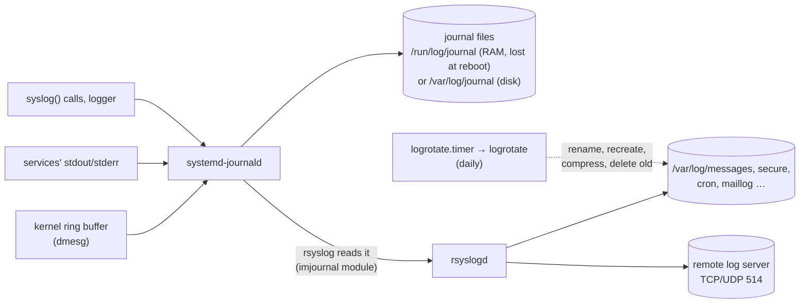

# 038 · Logging: journald, journalctl, rsyslog and logrotate

> **You need first:** [037 · systemd: services and targets](037-systemd-services-and-targets.md)
> **Next:** [039 · Job scheduling: cron and timers](039-job-scheduling-cron-and-timers.md)

---

## What it is

A **log** is a time-stamped record of what the system and its programs did. Linux has three logging pieces that work together:

| Piece | Job |
|---|---|
| **systemd-journald** | Collects **every** log message (kernel, services, programs' stdout/stderr, syslog calls) into a structured, indexed, **binary** journal. Read it with **`journalctl`** |
| **rsyslog** | The classic **syslog** daemon. It writes plain-text log files under `/var/log/` and can forward logs to a central server |
| **logrotate** | Renames, compresses and deletes old text logs so they don't fill the disk |

**syslog** is the old standard for log messages, where each message has a **facility** (which part of the system sent it) and a **priority** (how serious it is).

## Why it exists

Logs are how you find out what went wrong: why a service died at 03:12, who logged in, which disk threw errors, why SELinux blocked something. Without logs, troubleshooting is guessing. Without rotation and size limits, logs eventually fill the disk and **cause** outages.

## Analogy

journald is a **CCTV recorder** for the whole building. It records everything with labels (which camera, which room, what time) and lets you jump to "camera 3, yesterday, 09:00–10:00". rsyslog is a **clerk** who copies the important parts into **paper logbooks** (text files) by topic, and can **fax copies to head office** (a central log server). logrotate is the **archivist** who boxes up old logbooks and throws out the oldest boxes.

## How it works inside



On **Ubuntu** the text files are `/var/log/syslog` and `/var/log/auth.log` instead of `messages` and `secure`.

- **journald** stores each entry with **metadata fields**: `_SYSTEMD_UNIT` (which service), `_PID`, `_UID`, `PRIORITY`, `_BOOT_ID` (which boot), the hostname, and more. That's why `journalctl` can filter so precisely. Files are indexed and checksummed.
- **Where the journal lives** (setting `Storage=`; the defaults are in `/usr/lib/systemd/journald.conf`, and you override them with a drop-in in `/etc/systemd/journald.conf.d/`. RHEL 10 no longer ships `/etc/systemd/journald.conf` at all):
  - `auto` (RHEL default): **persistent only if `/var/log/journal/` exists**; otherwise it's kept in RAM in `/run/log/journal/` and **lost at reboot**.
  - `persistent`: always on disk. **Ubuntu** keeps the journal persistent by default.
  - `volatile`: RAM only.
- The journal limits its own size (by default about 10% of the filesystem, capped at 4 GiB). Set `SystemMaxUse=` for an explicit limit.
- **Kernel messages** go to an in-memory **ring buffer** (read it with `dmesg`), and journald also stores them (`journalctl -k`).
- **logrotate** runs daily from `logrotate.timer` (a systemd timer, topic 039). For each log it renames `messages` → `messages-20261116`, creates a fresh empty file, and deletes the oldest (RHEL keeps 4 weeks). Compression is **off** by default on RHEL (`#compress` in `/etc/logrotate.conf`); a file in `/etc/logrotate.d/` can turn it on with `compress`, as the example below does. A program that keeps the old file open must be told to reopen it (with a signal or reload in `postrotate`); this is the same inode story as topic 008.

### Priorities (severity)

| Number | Name | Meaning |
|---|---|---|
| 0 | emerg | System unusable |
| 1 | alert | Act immediately |
| 2 | crit | Critical |
| 3 | **err** | Error |
| 4 | **warning** | Warning |
| 5 | notice | Normal but significant |
| 6 | info | Informational |
| 7 | debug | Debug detail |

### Log files on RHEL vs Ubuntu

| Content | RHEL | Ubuntu/Debian |
|---|---|---|
| General system messages | `/var/log/messages` | `/var/log/syslog` |
| Logins, sudo, SSH (authentication) | `/var/log/secure` | `/var/log/auth.log` |
| cron | `/var/log/cron` | in `syslog` |
| Kernel | `journalctl -k` / `dmesg` | `/var/log/kern.log` too |
| Packages | `/var/log/dnf.log` | `/var/log/apt/history.log`, `/var/log/dpkg.log` |
| Audit + **SELinux denials** | `/var/log/audit/audit.log` (topic 077) | (AppArmor messages in `kern.log`/`syslog`) |
| Boot service messages | `/var/log/boot.log` | — |
| Login history (binary) | `/var/log/wtmp` (`last`), `/var/log/btmp` (`lastb`, failed logins) | same |
| App logs | `/var/log/<app>/` (`httpd/`, `nginx/`, `sssd/`) | same |

## Commands

### journalctl

| Task | Command |
|---|---|
| Everything (oldest first) | `journalctl` |
| Jump to the end / newest first | `journalctl -e` / `journalctl -r` |
| Last N lines / follow live | `journalctl -n 20` / `journalctl -f` |
| One service | `journalctl -u nginx` (several: `-u a -u b`) |
| This boot / previous boot / list boots | `journalctl -b` / `-b -1` / `--list-boots` |
| Kernel only | `journalctl -k` |
| By priority | `journalctl -p err` (err and worse); `-p warning..err` |
| Time window | `--since "2026-11-16 09:00" --until "1 hour ago"`, `--since today` |
| By PID / user / program | `_PID=2472`, `_UID=1000`, `journalctl /usr/sbin/sshd` |
| Text search | `journalctl -g 'Failed password'` |
| Extra explanations | `journalctl -xe` |
| Output formats | `-o short-iso`, `-o verbose`, `-o json-pretty`, `--no-pager` for scripts |
| Disk use / cleanup | `--disk-usage`; `--vacuum-size=500M`, `--vacuum-time=2weeks` |

```bash
journalctl -u sshd --since "1 hour ago" --no-pager | tail -3
```
```
Nov 16 15:20:11 server1 sshd-session[6120]: Failed password for invalid user admin from 203.0.113.50 port 40122 ssh2
Nov 16 15:20:13 server1 sshd-session[6120]: Connection closed by invalid user admin 203.0.113.50 port 40122 [preauth]
Nov 16 15:21:02 server1 sshd-session[6155]: Accepted publickey for alice from 192.168.56.1 port 51500 ssh2: ED25519 SHA256:...
```
- Date, host, program[PID], message. Someone is guessing passwords for `admin`, while alice logged in with a key.

```bash
journalctl -p err -b --no-pager | tail -3
```
```
Nov 16 08:50:12 server1 kernel: ata2.00: failed command: READ FPDMA QUEUED
Nov 16 08:51:40 server1 systemd[1]: Failed to start myapp.service - My application API.
```
- Every error since this boot: a quick health check after any reboot.

```bash
journalctl --list-boots
```
```
IDX BOOT ID                          FIRST ENTRY                 LAST ENTRY
 -1 4b2e1c9a7f8d4e3a9c0b1d2e3f4a5b6c Sun 2026-11-15 07:00:10 UTC Sun 2026-11-15 23:59:58 UTC
  0 9f8e7d6c5b4a39281706f5e4d3c2b1a0 Mon 2026-11-16 08:50:02 UTC Mon 2026-11-16 15:22:40 UTC
```
- Two boots listed = the journal is persistent. `journalctl -b -1` shows the previous boot, which is essential for "why did it crash/reboot?"

```bash
journalctl -u nginx -o verbose -n 1
```
```
    PRIORITY=6
    _UID=0
    _BOOT_ID=9f8e7d6c5b4a39281706f5e4d3c2b1a0
    _PID=1
    _COMM=systemd
    _SYSTEMD_UNIT=init.scope
    UNIT=nginx.service
    MESSAGE=Started nginx.service - The nginx HTTP and reverse proxy server.
...
```
- The structured fields behind each line. Fields starting with `_` are filled in by journald itself (trusted); the others come from the sender.
- Note who wrote this line: "Started nginx.service" comes from **systemd** (`_PID=1`, `_COMM=systemd`, `_SYSTEMD_UNIT=init.scope`). The service it is *about* is in `UNIT=`. `journalctl -u nginx` shows both nginx's own output and systemd's messages about it.
- Any field can be a filter: `journalctl _SYSTEMD_UNIT=nginx.service PRIORITY=3` (only lines nginx itself logged at "err").

Normal users only see their own entries unless they're in `wheel`, `adm` or `systemd-journal`.

### Making the journal persistent (RHEL)

```bash
sudo mkdir -p /var/log/journal
sudo systemd-tmpfiles --create --prefix /var/log/journal    # correct owner, permissions, SELinux label
sudo systemctl restart systemd-journald
sudo journalctl --flush                                      # move what's in RAM to disk now
```
or, explicitly:
```bash
sudo mkdir -p /etc/systemd/journald.conf.d
printf '[Journal]\nStorage=persistent\nSystemMaxUse=1G\n' | sudo tee /etc/systemd/journald.conf.d/persistent.conf
sudo systemctl restart systemd-journald
```
Check after the next reboot: `journalctl --list-boots` shows more than one boot.

### rsyslog

Config: `/etc/rsyslog.conf` plus `/etc/rsyslog.d/*.conf`. Each rule is `selector  action`, where the selector is `facility.priority`.

| Facilities | `auth`/`authpriv`, `cron`, `daemon`, `kern`, `mail`, `syslog`, `user`, `local0`–`local7` (free for your apps), `*` |
|---|---|
| Priority forms | `.crit` = crit **and worse**; `.=crit` = exactly crit; `.!crit` = less severe than crit; `.none` = exclude; `.*` = all |

| Action | Meaning |
|---|---|
| `/var/log/file` | Write to a file |
| `@host:514` / `@@host:514` | Forward over UDP / **TCP** |
| `*` | Message every logged-in terminal |

```bash
sudo tee /etc/rsyslog.d/myapp.conf <<'EOF'
local4.*        /var/log/myapp.log
authpriv.*      @@logs.example.com:514
EOF
sudo rsyslogd -N1               # syntax check
sudo systemctl restart rsyslog
logger -p local4.err "payment service timeout"
sudo tail -1 /var/log/myapp.log
```
```
Nov 16 15:30:02 server1 alice[6301]: payment service timeout
```
- `logger` writes a syslog message from the shell, which is handy in scripts.

For a central **receiver**: load `imtcp` with `input(type="imtcp" port="514")`, open the port in the firewall (topic 071), and use TLS in production.

### logrotate

```bash
sudo tee /etc/logrotate.d/myapp <<'EOF'
/var/log/myapp/*.log {
    weekly
    rotate 8
    compress
    delaycompress
    missingok
    notifempty
    create 0640 root root
    postrotate
        systemctl reload myapp >/dev/null 2>&1 || true
    endscript
}
EOF
sudo logrotate -d /etc/logrotate.d/myapp    # dry run: shows what it would do
sudo logrotate -f /etc/logrotate.d/myapp    # force a rotation now
systemctl list-timers logrotate.timer
```

| Option | Meaning |
|---|---|
| `daily`/`weekly`/`monthly` | How often |
| `rotate N` | Keep N old files |
| `size 100M` | Rotate when bigger than this (ignores the schedule) |
| `compress` / `delaycompress` | gzip old files / don't compress the most recent old one yet |
| `dateext` | Add `-YYYYMMDD` instead of `.1` (RHEL default) |
| `create MODE OWNER GROUP` | Make a fresh empty file |
| `copytruncate` | Copy then truncate in place, for apps that can't reopen files (may lose a few lines) |
| `missingok`, `notifempty` | No error if missing / skip if empty |
| `postrotate … endscript` | Command after rotation (usually reload the app so it reopens the file) |

### Login records

```bash
last -n 5        # login and reboot history
sudo lastb -n 5  # failed logins
```

### Try it
1. `journalctl -b -p warning` on your VM. What's the most serious message?
2. Make the journal persistent, reboot, then run `journalctl -b -1 -n 5`.
3. Write `/etc/rsyslog.d/test.conf` with `local5.* /var/log/local5.log`, restart rsyslog, `logger -p local5.info hello`, and check the file.
4. Create a logrotate config for `/var/log/local5.log` and test it with `-d`, then `-f`.

**Check your work:** on your lab VM, from the notes folder, run `sudo ./checks/check 038` for every step, or `sudo ./checks/check 038 STEP` for one (topic 002 shows how to get the notes there).

## Where you'll use it

- **Every incident:** `journalctl -u <service> --since …`, `journalctl -b -1` after an unexpected reboot, `journalctl -k` for disk and OOM messages.
- **Security:** failed logins in `secure`/`auth.log`, sudo usage, SELinux denials in `audit.log`.
- **Central logging:** in production, logs are shipped off the host (rsyslog, Fluent Bit, Vector, the Elastic agent) to a central system (Loki, Elasticsearch, Splunk, a cloud logging service). If a host dies or is hacked, its local logs are gone or untrustworthy.
- **Containers:** apps log to stdout/stderr; the container runtime captures it (`podman logs`, `kubectl logs`). With Podman under systemd, it goes to the journal.
- **Disk-full incidents:** a runaway log, or a journal with no size cap. `journalctl --vacuum-size=`, logrotate, and a separate `/var` filesystem.

## When it breaks

| Symptom | Cause | Fix |
|---|---|---|
| `journalctl -b -1` → "Data from the specified boot is not available" | The journal is in RAM only | Make it persistent |
| `/var/log/messages` gets no new lines | rsyslog stopped, or a config error | `systemctl status rsyslog`; `rsyslogd -N1` |
| A custom rsyslog rule writes nothing | Wrong facility/priority, or not restarted | Test with `logger -p …`; restart rsyslog |
| `/var` full of logs | No rotation, or a huge journal | `logrotate -f`; `journalctl --vacuum-size=…`; set `SystemMaxUse` |
| An app keeps writing to the rotated file (`app.log-2026…`) | It still holds the old inode | Add `postrotate` reload, or `copytruncate` |
| Disk space not freed after deleting a log | Still open by a process (topic 008) | `lsof +L1`; restart or reload the process |
| Remote logs not arriving | Firewall, SELinux port label, UDP/TCP mismatch | Open the port; match `@` with imudp and `@@` with imtcp |
| A user can't see system logs with journalctl | Not in a log-reading group | Add them to `systemd-journal` (or `adm`) |

## Quick recap

- journald collects everything with metadata. `journalctl -u SVC`, `-b`, `-b -1`, `-p err`, `--since`, `-f`, `-k`, `-g`.
- RHEL's journal is persistent only if `/var/log/journal` exists (or `Storage=persistent`). Cap it with `SystemMaxUse`.
- rsyslog writes text files (`/var/log/messages`, `secure`; Ubuntu `syslog`, `auth.log`) and forwards logs. Rules are `facility.priority action`; test with `logger`.
- logrotate (daily timer) rotates and deletes old logs (compression only if you enable `compress`; off by default on RHEL); `postrotate` makes apps reopen their files.

**Interview questions**

1. *journald vs rsyslog?* journald is systemd's structured, indexed binary journal with rich metadata. rsyslog writes traditional text files and forwards to central servers. On RHEL, rsyslog reads its input from journald.
2. *How do you make the journal survive reboots?* Create `/var/log/journal` (then `systemd-tmpfiles --create` and restart journald), or set `Storage=persistent` in a journald drop-in.
3. *An app keeps writing to `app.log-20261116` after rotation. Why?* It still has the old file (inode) open. logrotate renamed it but the app never reopened. Add a `postrotate` reload/signal, or use `copytruncate`.

**Scenario question** (answer out loud first, then compare)

> *"A server rebooted unexpectedly overnight. How do you find out why?"*

**Model answer:**
1. `last -x reboot shutdown | head` and `journalctl --list-boots`: when it went down and came back.
2. **The previous boot's last messages**: `journalctl -b -1 -n 100`, and `-p warning`. This needs a **persistent journal**; otherwise those logs were in RAM and are gone.
3. Clean shutdown or crash?
   - Clean: you'll see systemd stopping units, and who or what asked (`systemd-logind`, a `shutdown` command, an update tool).
   - Crash or power loss: the log just stops.
4. Kernel panics: check `/var/crash` if kdump is configured (topic 103); hypervisor or BMC logs for power and hardware events.
5. Also check `/var/log/messages` and the hypervisor's events (live migration, host failure).

**Likely follow-ups:**
- *How do you make the journal persistent on RHEL?* Create `/var/log/journal` (or `Storage=persistent`) and restart journald.
- *How do you test an rsyslog rule?* `logger -p local5.info "test"` and check the target file.
