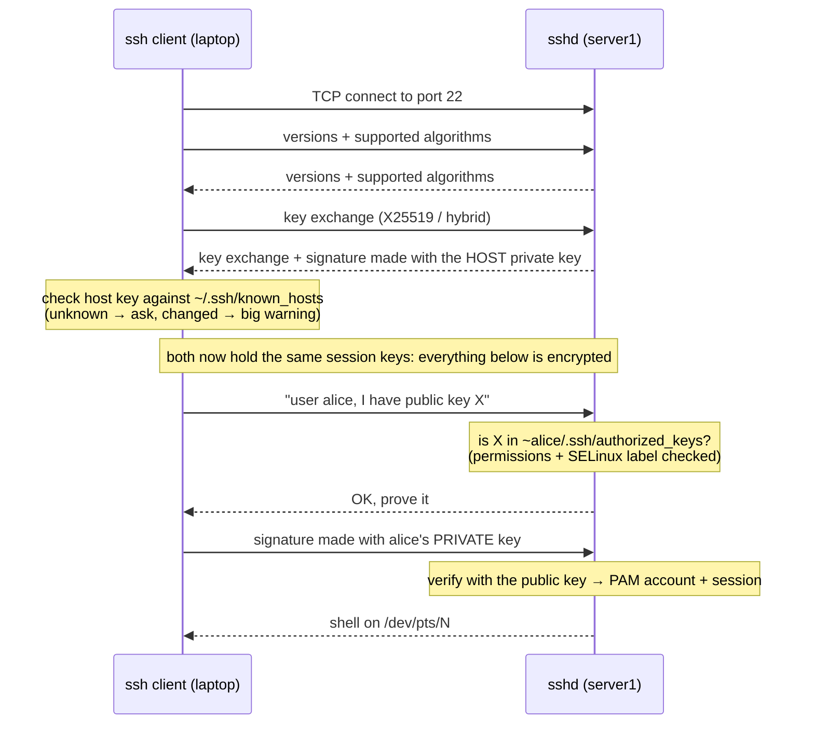

# 065 · SSH: Remote Login, Keys and Secure File Transfer

> **You need first:** [064 · Cryptography basics](064-cryptography-basics.md)
> **Next:** [066 · SSH server hardening](066-ssh-server-hardening.md)

---

## What it is

**SSH** (Secure SHell) gives you an **encrypted** connection to another machine over the network (TCP port **22**). Through it you can:
- log in and get a shell (a pseudo-terminal, topic 003);
- run a single remote command;
- copy files (`scp`, `sftp`, `rsync`);
- tunnel other traffic (topic 067).

On RHEL the client is `ssh` (package `openssh-clients`) and the server is `sshd` (package `openssh-server`, service `sshd.service`, enabled by default). RHEL 10 ships OpenSSH 9.9. Ubuntu Server ships OpenSSH too (9.6 on 24.04), as service `ssh`, and since 24.04 it is **socket-activated**: `ssh.socket` listens on port 22 and starts sshd per connection, so `ssh.service` shows as disabled.

SSH replaced **Telnet**, **rlogin** and **rsh**, which sent everything, including passwords, in plain text.

## Why it exists

Servers live in data centres and clouds; you manage them remotely. SSH gives you a secure terminal, file transfer and automation channel (Ansible, Git, CI deployments, `kubectl` jump hosts all use SSH). **Key-based login** lets people and scripts authenticate without passwords, more securely than passwords.

## Analogy

- **Host key** = the **building's official ID badge**. When you arrive, the receptionist shows it, and you compare it with the photo you saved the first time (`known_hosts`). If it doesn't match, someone may be impersonating the building.
- **User key pair** = a **personal lock and key**. You give the building a copy of your **lock** (public key) to fit on your office door (`authorized_keys`). Only your **key** (private key, which never leaves your pocket) opens it.
- **ssh-agent** = a **key valet** who holds your key for the day, so you only unlock your keychain (type the passphrase) once.

## How it works inside

### What happens when you run `ssh alice@server1`

1. **TCP connection** to port 22; both sides announce their SSH versions and algorithms.
2. **Key exchange** (X25519 or post-quantum hybrid, topic 064): both sides derive the same **session keys**. From now on everything is encrypted (AES-GCM or ChaCha20).
3. **Server authentication:** the server signs the exchange with its **host key**. The client checks that key against `~/.ssh/known_hosts`. On first contact you're asked to confirm the fingerprint, and it's then saved.
4. **User authentication** (most common first):
   - **Public key:** the client says "I have key X". If X is in alice's `~/.ssh/authorized_keys` on the server, the server sends a challenge; the client **signs it with the private key**; the server verifies the signature with the public key. **The private key never leaves your machine.**
   - **Password:** sent inside the encrypted channel and checked by PAM (topic 029).
5. sshd starts a session process as alice, allocates a **PTS** (topic 003), runs PAM's account/session steps, and starts her login shell.



### Host keys vs user keys

| | Host keys | User keys |
|---|---|---|
| Belong to | The **server** | A **user** |
| Location | `/etc/ssh/ssh_host_ed25519_key` (+ `.pub`), also ECDSA/RSA | `~/.ssh/id_ed25519` (+ `.pub`) |
| Prove | "This really is server1" (prevents man-in-the-middle attacks) | "This really is alice" (login without a password) |
| Recorded where | Client: `~/.ssh/known_hosts` | Server: `~/.ssh/authorized_keys` |

### Files and required permissions

| File | Purpose | Mode |
|---|---|---|
| `~/.ssh/` | Your SSH directory | `700` |
| `~/.ssh/id_ed25519` | **Private** key | `600` |
| `~/.ssh/id_ed25519.pub` | Public key | `644` |
| `~/.ssh/authorized_keys` | Public keys allowed to log in **as this user** | `600` |
| `~/.ssh/known_hosts` | Host keys of servers you trust | `600`/`644` |
| `~/.ssh/config` | Your client settings | `600` |
| `/etc/ssh/ssh_config(.d/)` | System-wide client settings | |
| `/etc/ssh/sshd_config(.d/)` | Server settings (topic 066) | |

**sshd refuses keys if `~/.ssh` or `authorized_keys` is writable by others** ("StrictModes"), because someone else could add their key. On RHEL, those files also need the right **SELinux label** (`ssh_home_t`); `restorecon -Rv ~/.ssh` fixes it (topic 073).

## Commands

### Connect

```bash
ssh alice@192.168.56.11
```
```
The authenticity of host '192.168.56.11 (192.168.56.11)' can't be established.
ED25519 key fingerprint is SHA256:Vz8bE5…q1Ow.
This key is not known by any other names.
Are you sure you want to continue connecting (yes/no/[fingerprint])? yes
Warning: Permanently added '192.168.56.11' (ED25519) to the list of known hosts.
alice@192.168.56.11's password:
[alice@server2 ~]$
```
- For important servers, compare the fingerprint with the real one, obtained through a trusted channel. On the server: `ssh-keygen -lf /etc/ssh/ssh_host_ed25519_key.pub`.

```bash
ssh -p 2222 alice@server2                       # a different port
ssh alice@server2 'uptime; df -h /'             # run commands and come back
ssh -t alice@server2 'sudo systemctl restart nginx'   # -t: force a terminal (needed for sudo prompts)
ssh -i ~/.ssh/deploy_key deploy@server2         # use a specific key
```

### Set up key-based login

```bash
ssh-keygen
```
```
Generating public/private ed25519 key pair.
Enter file in which to save the key (/home/alice/.ssh/id_ed25519):
Enter passphrase for "/home/alice/.ssh/id_ed25519" (empty for no passphrase):
Your identification has been saved in /home/alice/.ssh/id_ed25519
Your public key has been saved in /home/alice/.ssh/id_ed25519.pub
The key fingerprint is:
SHA256:Gq7x…k2E alice@server1
```
- RHEL 10 defaults to **Ed25519** (`-t rsa -b 4096` if an old system needs RSA). Use a **passphrase**: it encrypts the private key file, so a stolen file is useless without it.

```bash
ssh-copy-id alice@server2
ssh alice@server2
```
```
Number of key(s) added: 1

Now try logging into the machine, with: "ssh 'alice@server2'"
and check to make sure that only the key(s) you wanted were added.

[alice@server2 ~]$
```
- `ssh-copy-id` appends your public key to `~alice/.ssh/authorized_keys` on server2 and sets the correct permissions. The next login uses the key (asking for the **key passphrase**, not the account password).

Manually, when `ssh-copy-id` isn't available:
```bash
cat ~/.ssh/id_ed25519.pub | ssh alice@server2 \
  'mkdir -p ~/.ssh && chmod 700 ~/.ssh && cat >> ~/.ssh/authorized_keys && chmod 600 ~/.ssh/authorized_keys && restorecon -R ~/.ssh'
```
- Never `scp` a key **over** `authorized_keys`: that deletes every other key in it.

### ssh-agent

```bash
eval "$(ssh-agent -s)"     # desktop sessions usually start one for you
ssh-add                    # unlock your key once (asks for the passphrase)
ssh-add -l                 # list loaded keys
```

### Copy files

```bash
scp report.txt alice@server2:/tmp/              # local → remote
scp alice@server2:/etc/hosts ./hosts.server2    # remote → local
scp -r project/ alice@server2:~/                # a directory
scp -P 2222 file alice@server2:/tmp/            # port is a CAPITAL -P for scp
sftp alice@server2                              # interactive: ls, cd, get, put, lcd, bye
rsync -av project/ alice@server2:/srv/project/  # efficient and resumable (topic 068)
```
- OpenSSH 9's `scp` uses the SFTP protocol underneath.

### Client config: aliases

```
# ~/.ssh/config
Host web1
    HostName 192.168.56.11
    User alice
    Port 22
    IdentityFile ~/.ssh/id_ed25519

Host *.prod.example.com
    User ops
    ProxyJump bastion.example.com
    ServerAliveInterval 30
```
```bash
ssh web1 ; scp file web1:/tmp/
```
- `ProxyJump` goes through a **bastion** (a hardened jump host; topic 067). `ServerAliveInterval` keeps idle sessions from being dropped by firewalls.

### On the server

```bash
systemctl status sshd                      # Ubuntu: systemctl status ssh
sudo ss -tlnp | grep sshd
sudo journalctl -u sshd -n 20              # or /var/log/secure (Ubuntu: /var/log/auth.log)
```
```
LISTEN 0 128 0.0.0.0:22 0.0.0.0:* users:(("sshd",pid=1050,fd=3))
LISTEN 0 128    [::]:22    [::]:* users:(("sshd",pid=1050,fd=4))
```

### Debugging: `ssh -v`

```bash
ssh -v alice@server2 2>&1 | grep -E 'Offering|Authentications|Server accepts|denied'
```
```
debug1: Authentications that can continue: publickey,gssapi-keyex,gssapi-with-mic,password
debug1: Offering public key: /home/alice/.ssh/id_ed25519 ED25519 SHA256:Gq7x…
debug1: Server accepts key: /home/alice/.ssh/id_ed25519 ED25519 SHA256:Gq7x…
```
- Shows which methods the server allows and which keys were offered and accepted. `-vvv` gives even more detail.

### Try it
1. As alice on server1, create a key and set up key login to server2. Confirm no account password is asked.
2. On server2, `chmod 777 ~/.ssh` and try again (refused). Read `/var/log/secure` on server2, then fix it.
3. Write a `~/.ssh/config` alias and copy a file with `scp` using the alias.
4. Reinstall (or regenerate the host keys on) server2 and see the "REMOTE HOST IDENTIFICATION HAS CHANGED" warning. Remove the old entry with `ssh-keygen -R`.

**Check your work:** on your lab VM, from the notes folder, run `sudo ./checks/check 065` for every step, or `sudo ./checks/check 065 STEP` for one (topic 002 shows how to get the notes there).

## Where you'll use it

- **Daily administration** of every Linux server, physical or cloud. Cloud VMs are usually created with your public key injected (cloud-init, topic 104), with password login off.
- **Automation:** Ansible connects over SSH with keys; CI/CD deploy jobs use deploy keys; Git over SSH.
- **Bastions/jump hosts** for reaching private networks (`ProxyJump`).
- **Kubernetes:** nodes are administered over SSH (or the cloud's session manager); `kubectl` itself uses HTTPS instead.

## When it breaks

| Symptom | Cause | Fix |
|---|---|---|
| `Connection closed by HOST port 22` right after a few failed logins (the server log says `drop connection … penalty: failed authentication`) | OpenSSH 9.8+ **PerSourcePenalties**: after failed authentications, sshd refuses that source address for 15 s or more, growing with repeated failures | Wait and retry with the right credentials. Exempt trusted admin networks with `PerSourcePenaltyExemptList` in sshd_config (topic 066) |
| `Connection refused` | sshd isn't running, or a wrong port | `systemctl status sshd`; `ss -tlnp`; `-p PORT` |
| `Connection timed out` | Firewall or routing | `firewall-cmd --list-services` (topic 071); network path (topics 058–061) |
| `Permission denied (publickey)` | The key isn't in `authorized_keys`, wrong permissions/owner, wrong SELinux label, or a password-only/key-only policy | `ssh -v`; `chmod 700 ~/.ssh; chmod 600 ~/.ssh/authorized_keys`; `restorecon -Rv ~/.ssh`; read the server's `/var/log/secure` |
| Keys set up, but it still asks for a password | The wrong key is offered, or the key isn't loaded | `ssh -v`; `-i KEY`; `ssh-add` |
| `WARNING: REMOTE HOST IDENTIFICATION HAS CHANGED!` | The host key changed: a reinstall, or an attack | Verify through a trusted channel, then `ssh-keygen -R host` |
| `Too many authentication failures` | The agent offers too many keys | `ssh -o IdentitiesOnly=yes -i KEY …` |
| `scp` fails with strange output | A remote startup file prints text (topic 025) | Guard output in `~/.bashrc` |
| Slow login (several seconds) | Reverse DNS lookups on the server, or GSSAPI attempts | `UseDNS no` (default on RHEL); `GSSAPIAuthentication no` |

## Quick recap

- SSH = encrypted remote shell, commands, file copy and tunnels on TCP 22. **Host keys** prove the server (`known_hosts`); **user keys** prove the user (`authorized_keys`).
- Key login: `ssh-keygen` (Ed25519, with a passphrase) → `ssh-copy-id user@host` → `ssh user@host`. Permissions: `~/.ssh` 700, `authorized_keys` and private keys 600, plus `restorecon` on RHEL.
- Files: `scp` (port `-P`), `sftp`, `rsync -av`. Aliases and jump hosts in `~/.ssh/config`.
- Debug with `ssh -v` (client) and `journalctl -u sshd` / `/var/log/secure` (server).

**Interview questions**

1. *How does SSH key-based authentication work?* The server stores your public key in `authorized_keys`. When you connect, the server challenges you, your client signs the challenge with your private key, and the server verifies the signature with the public key. The private key never leaves your machine.
2. *Host key vs user key?* The host key authenticates the server to the client (checked against `known_hosts`, preventing man-in-the-middle attacks). The user key authenticates the user to the server (checked against `authorized_keys`).
3. *What does "REMOTE HOST IDENTIFICATION HAS CHANGED" mean, and what do you do?* The server's host key differs from the one you saved: either the server was rebuilt or someone is intercepting. Verify the new fingerprint through a trusted channel before removing the old entry with `ssh-keygen -R`.

**Scenario question** (answer out loud first, then compare)

> *"You copied your public key to a server, but SSH still asks for a password. How do you debug it?"*

**Model answer:**
1. **Client side:** `ssh -v user@host`. Does it offer the key ("Offering public key"), and does the server reject it or never ask? Make sure the right key is used (`-i`, `IdentitiesOnly`).
2. **Server side:** `journalctl -u sshd` or `/var/log/secure`. sshd says why: "Authentication refused: bad ownership or modes for directory /home/alice/.ssh".
3. Common causes:
   - `~/.ssh` not 700, `authorized_keys` not 600, or the home directory writable by others (StrictModes);
   - a wrong **SELinux label** after copying files around: `restorecon -Rv ~/.ssh`;
   - the key pasted with line breaks, or into the wrong user's file;
   - `PubkeyAuthentication no`, or an `AuthorizedKeysFile` setting pointing elsewhere (`sshd -T | grep -i authorized`).

**Likely follow-ups:**
- *What does the host key protect against?* A man-in-the-middle impersonating the server.
- *Why should a private key have a passphrase?* If the file is stolen, it's useless without it; ssh-agent avoids retyping it.
