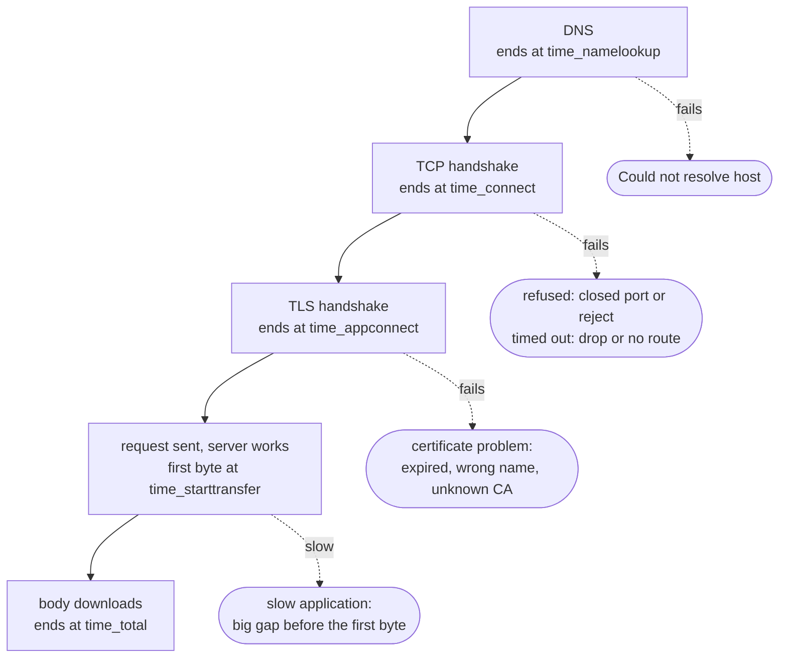

# 070 · HTTP, HTTPS and curl for Operators

> **You need first:** [069 · Time sync with chrony](069-time-sync-chrony.md)
> **Next:** [071 · firewalld](071-firewalld.md)

---

## What it is

- **HTTP** (HyperText Transfer Protocol): the request/response protocol of the web **and of almost every API**: REST services, Kubernetes, cloud APIs, health checks, webhooks, metrics endpoints.
- **HTTPS**: HTTP inside a **TLS**-encrypted connection (topic 064). Default ports: **80** (HTTP), **443** (HTTPS).
- **curl**: the command-line tool to make HTTP(S) requests and see exactly what happens. It's the most-used debugging tool in DevOps.
- **URL** (Uniform Resource Locator): `https://api.example.com:8443/v1/users?id=7`, made of a **scheme** (`https`), **host**, optional **port**, **path** (`/v1/users`) and **query string** (`?id=7`).
- **Header**: a `Name: value` line of metadata sent with a request or response (`Content-Type: application/json`).
- **Body**: the actual content (HTML, JSON, a file).
- **Status code**: a 3-digit result number (`200` OK, `404` Not Found, `502` Bad Gateway).
- **API** (Application Programming Interface): a way for programs to talk to a service, here over HTTP, usually exchanging **JSON** (JavaScript Object Notation, a text format of key/value data).

## Why it exists

Modern infrastructure talks HTTP. When "the app is down", you need to know **which layer** fails: DNS, TCP connect, TLS handshake, the proxy, or the application returning an error. curl separates these layers, and status codes plus headers tell you what the server actually said.

## Analogy

HTTP is **ordering at a counter**. You say a **verb** and an **item** ("GET /menu", "POST /orders" with your order written on a slip = the body). You add notes on the slip (**headers**: "I'd like JSON", "here's my loyalty card" = an auth token). The server replies with a **result code** ("200 here you go", "404 we don't have that", "500 the kitchen is on fire"), its own notes (headers) and the food (body). HTTPS is having this conversation inside a **soundproof booth** after checking the server's ID (its certificate).

## How it works inside

### What happens on `curl https://api.example.com/health`

1. **DNS**: resolve `api.example.com` (topic 063).
2. **TCP**: three-way handshake to port 443 (topic 058).
3. **TLS handshake**: the client sends **SNI** (Server Name Indication: which hostname it wants, so one IP can host many sites). The server sends its **certificate chain**. The client verifies the chain, the dates and the name (topic 064). Both agree on session keys.
4. **HTTP request**:
   ```
   GET /health HTTP/1.1
   Host: api.example.com
   User-Agent: curl/8.12.1
   Accept: */*
   ```
5. **HTTP response**:
   ```
   HTTP/1.1 200 OK
   Content-Type: application/json
   Content-Length: 15

   {"status":"ok"}
   ```
6. The connection is kept open for more requests ("keep-alive") or closed.

Each phase has its own way of failing, and `curl -w` (below) times each one:



**HTTP/2** sends many requests in parallel over one connection, in binary. **HTTP/3** runs over **QUIC** (on UDP). The meaning of methods, headers and status codes is the same in every version.

### Methods

| Method | Meaning | Changes data? |
|---|---|---|
| `GET` | Fetch something | No |
| `HEAD` | Same as GET, but headers only | No |
| `POST` | Create something / submit data | Yes |
| `PUT` | Replace something | Yes |
| `PATCH` | Partly update something | Yes |
| `DELETE` | Remove something | Yes |
| `OPTIONS` | Ask what's allowed (CORS pre-flight) | No |

### Status codes: the first digit tells you who's at fault

| Range | Meaning | Common ones |
|---|---|---|
| **1xx** | Informational | 101 Switching Protocols (WebSockets) |
| **2xx** | Success | **200** OK, **201** Created, **204** No Content |
| **3xx** | Redirect: look elsewhere | **301** Moved Permanently, **302**/**307** temporary, **304** Not Modified (use your cache) |
| **4xx** | **Client** error: the request was wrong | **400** Bad Request, **401** Unauthorized (not logged in), **403** Forbidden (logged in but not allowed, or a file-permission/SELinux problem on the server), **404** Not Found, **405** Method Not Allowed, **429** Too Many Requests (rate limited) |
| **5xx** | **Server** error | **500** Internal Server Error (the app crashed), **502** Bad Gateway (the proxy got a bad answer or none from the backend), **503** Service Unavailable (overloaded / no healthy backends), **504** Gateway Timeout (the backend was too slow) |

**502/503/504 almost always mean "the reverse proxy or load balancer is fine, but the app behind it isn't"** (topic 078).

### Headers you'll meet

| Header | Purpose |
|---|---|
| `Host` | Which site on this IP (virtual hosting) |
| `Content-Type` | What the body is (`application/json`, `text/html`) |
| `Content-Length` | Body size in bytes |
| `Authorization` | Credentials: `Bearer <token>` or `Basic <base64 user:pass>` |
| `Location` | Where a redirect points |
| `Cache-Control`, `ETag` | Caching rules |
| `Set-Cookie` / `Cookie` | Session cookies |
| `X-Forwarded-For`, `X-Forwarded-Proto` | Added by proxies: the real client IP and the original scheme |
| `Server` | The server software (often hidden for security) |

## Commands

### The basics

```bash
curl https://example.com/                          # print the body
curl -I https://example.com/                       # HEAD: headers only
curl -sS -o /dev/null -w '%{http_code}\n' https://example.com/   # just the status code
```
```
HTTP/2 200
date: Tue, 17 Nov 2026 00:35:25 GMT
content-type: text/html; charset=utf-8
server: cloudflare
last-modified: Mon, 16 Nov 2026 00:26:08 GMT
...
200
```

| Option | Meaning |
|---|---|
| `-v` | Verbose: show DNS, connect, TLS and **request/response headers** |
| `-s` / `-S` | Silent / but still show errors (`-sS` together) |
| `-f` | **Fail** (exit non-zero) on HTTP 4xx/5xx; essential in scripts |
| `-L` | Follow redirects |
| `-o FILE` / `-O` | Save the body to FILE / under the remote name |
| `-I` | HEAD request |
| `-X METHOD` | Use a method (`-X DELETE`) |
| `-H 'Name: value'` | Add a header |
| `-d DATA` / `--json DATA` | Send a body (POST); `--json` also sets the JSON headers |
| `-u user:pass` | Basic authentication |
| `-k` | **Skip certificate checks** (testing only ⚠️) |
| `--resolve host:port:IP` | Force a hostname to an IP (test a server before changing DNS) |
| `--connect-timeout 3` / `--max-time 10` | Don't hang forever |
| `-w FORMAT` | Print timings and info after the transfer |

### See everything: `-v`

```bash
curl -v https://example.com/ -o /dev/null
```
```
* Host example.com:443 was resolved.
* IPv6: (none)
* IPv4: 104.20.23.154, 172.66.147.243
*   Trying 104.20.23.154:443...
* ALPN: curl offers h2,http/1.1
* TLSv1.3 (OUT), TLS handshake, Client hello (1):
*  CAfile: /etc/pki/tls/certs/ca-bundle.crt
* TLSv1.3 (IN), TLS handshake, Server hello (2):
...
* SSL connection using TLSv1.3 / TLS_AES_256_GCM_SHA384 / X25519MLKEM768 / id-ecPublicKey
* ALPN: server accepted h2
* Server certificate:
*  subject: CN=example.com
*  start date: Sep 26 22:49:11 2026 GMT
*  expire date: Dec 25 22:56:35 2026 GMT
*  subjectAltName: host "example.com" matched cert's "example.com"
*  issuer: C=US; O=SSL Corporation; CN=Cloudflare TLS Issuing ECC CA 3
*  SSL certificate verify ok.
...
* Connected to example.com (104.20.23.154) port 443
...
> GET / HTTP/2
> Host: example.com
> User-Agent: curl/8.12.1
> Accept: */*
>
< HTTP/2 200
< content-type: text/html; charset=utf-8
```
- `*` lines = curl's own steps (DNS, TCP, TLS, certificate checks). `>` = what **you sent**. `<` = what the **server answered**. Where the output stops tells you which layer failed.
- `CAfile` is the trust store curl checks the certificate against (RHEL's system bundle, topic 064).
- `X25519MLKEM768` is the key exchange: classic X25519 combined with ML-KEM, a **post-quantum** algorithm. RHEL 10's OpenSSL 3.5 offers it by default, and many big sites accept it.

### Time each phase

```bash
curl -sS -o /dev/null -w 'dns=%{time_namelookup} connect=%{time_connect} tls=%{time_appconnect} ttfb=%{time_starttransfer} total=%{time_total} code=%{http_code}\n' https://www.redhat.com/
```
```
dns=0.453051 connect=0.498890 tls=0.651510 ttfb=0.735526 total=0.736675 code=301
```
- The times are **cumulative** seconds: DNS took 0.45 s (a slow resolver!), TCP 0.05 s, TLS 0.15 s, then the server took about 0.08 s to send the first byte (**TTFB**, Time To First Byte). The biggest step tells you where to look.

### APIs and JSON

```bash
curl -sS -H 'Accept: application/json' https://api.github.com/repos/torvalds/linux | jq '.stargazers_count, .license.spdx_id'
curl -sS -X POST https://httpbin.org/post --json '{"name":"web1","env":"prod"}' | jq .json
curl -sS -H "Authorization: Bearer $TOKEN" https://api.example.com/v1/me
```
```
189000
"GPL-2.0"
{
  "env": "prod",
  "name": "web1"
}
```
- **`jq`** (`dnf install jq`) parses and filters JSON. `.field` picks a value, `.[]` iterates over a list, `-r` prints raw strings without quotes.
- Put tokens in variables or files, **not** typed on the command line (topic 015).

### Test a server before DNS points to it

```bash
curl -v --resolve www.example.com:443:10.0.0.25 https://www.example.com/
```
- Connects to `10.0.0.25` but sends SNI and `Host` for `www.example.com`, exactly as real clients will after the DNS change.

### Health checks in scripts

```bash
if curl -fsS --max-time 5 http://localhost:8080/health >/dev/null; then
    echo healthy
else
    echo "unhealthy (exit $?)" >&2
fi
```
- Without `-f`, curl exits **0 even on a 500 error page**.

### Quick local web servers for testing

```bash
python3 -m http.server 8000                     # serves the current directory
curl -sI http://localhost:8000/
```

`wget` is another downloader (`wget URL`, `wget -qO- URL`). curl is preferred for debugging and APIs.

### Try it
1. `curl -v https://www.redhat.com/ -o /dev/null` and label each line: DNS, TCP, TLS, request, response.
2. Get only the status code for `http://redhat.com` with and without `-L`. Why do they differ?
3. Time three different sites with the `-w` format and find which phase dominates for each.
4. Run `python3 -m http.server`, request a file that exists and one that doesn't, and compare the codes.

**Check your work:** on your lab VM, from the notes folder, run `sudo ./checks/check 070` for every step, or `sudo ./checks/check 070 STEP` for one (topic 002 shows how to get the notes there).

## Where you'll use it

- **Health checks:** load balancers, Kubernetes **liveness/readiness probes** (an HTTP GET that must return 2xx/3xx), uptime monitors.
- **Debugging "the site is down":** `curl -v` from the client side, from the proxy, and from the backend host itself (`curl localhost:8080`) to find which hop fails.
- **APIs everywhere:** the Kubernetes API (`kubectl` is an HTTPS client; `kubectl get pods -v=8` shows its HTTP calls), cloud APIs, CI webhooks, Prometheus metrics (`curl localhost:9100/metrics`).
- **Certificate checks** before expiry, and testing new certificates with `--resolve`.

## When it breaks

| Symptom (curl error) | Layer | Next step |
|---|---|---|
| `Could not resolve host` | DNS | topic 063 |
| `Connection refused` | Nothing listening on that port (or a firewall REJECT) | `ss -tlnp` on the server (topic 095) |
| `Connection timed out` | Firewall DROP, routing, host down | Firewall (topic 071), routing (topic 061) |
| `SSL certificate problem: unable to get local issuer certificate` | Untrusted CA or incomplete chain | Add the CA; fix the server chain (topic 064) |
| `SSL: no alternative certificate subject name matches target host name` | Wrong certificate for that name | Use the right name; reissue the certificate |
| `certificate has expired` | Expired | Renew |
| `HTTP 403` | Permissions, SELinux label, or access rules on the server | Server error log; `ls -Z` (topic 073) |
| `HTTP 404` | Wrong path, or wrong virtual host (`Host` header) | Check the URL and the vhost config |
| `HTTP 502/504` | The proxy can't reach the backend, or it's too slow | Check the backend service and its port; proxy logs (topic 078) |
| `HTTP 503` | Overloaded, maintenance, no healthy backends | Backend health, capacity |
| Hangs forever | No timeout set | `--connect-timeout`, `--max-time` |

## Quick recap

- HTTP = method + URL + headers + optional body → status code + headers + body. HTTPS = the same inside TLS (SNI, certificate check).
- 2xx success, 3xx redirect, **4xx client problem**, **5xx server problem** (502/503/504 = the backend behind a proxy).
- `curl -v` shows DNS → TCP → TLS → request (`>`) → response (`<`). `-w` with timings finds the slow phase. `-f` for scripts. `--resolve` to test before DNS changes. `jq` for JSON.
- Debug from the outside in: client → proxy → backend `localhost`.

**Interview questions**

1. *What's the difference between a 502 and a 504?* Both come from a proxy or load balancer. 502 means the backend returned an invalid response or refused or dropped the connection; 504 means the backend didn't respond in time.
2. *How would you find out why an HTTPS request is slow?* `curl -w` with `time_namelookup`, `time_connect`, `time_appconnect` and `time_starttransfer` shows whether DNS, TCP connect, the TLS handshake or the server's processing time dominates.
3. *401 vs 403?* 401 means you're not authenticated (no or invalid credentials). 403 means you're authenticated (or authentication doesn't matter) but not allowed to access the resource.

**Scenario question** (answer out loud first, then compare)

> *"Users get intermittent 502 errors from a site behind nginx. How do you narrow it down?"*

**Model answer:**
1. A 502 comes **from the proxy**: nginx got no valid response from the backend.
2. nginx's error log names the reason and the upstream:
   - "connect() failed (111: Connection refused)" → backend down or restarting;
   - "(13: Permission denied)" → SELinux `httpd_can_network_connect`;
   - "upstream prematurely closed connection" → the backend crashed mid-request.
3. Test the backend **directly**, bypassing nginx: `curl -v http://127.0.0.1:8080/health`.
4. Intermittent? Check:
   - the backend's restarts (`journalctl -u app`, OOM kills);
   - one bad server in a pool of several;
   - connection limits: backend worker pool full, `ss -lnt` Recv-Q at the backend's listen queue.
5. Time the phases with `curl -w` from the client and from the proxy host.

**Likely follow-ups:**
- *502 vs 504?* 502 = bad or no response; 504 = the backend took too long.
- *How do you test a site on a new IP before changing DNS?* `curl --resolve site.example.com:443:NEW_IP https://site.example.com/`.
