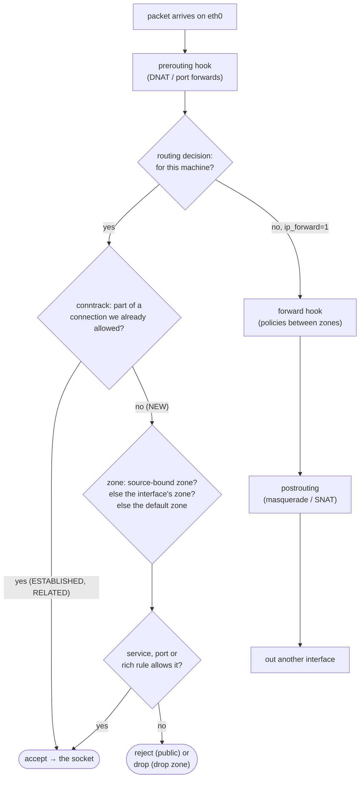

# 071 · firewalld: Zones, Services, Ports and Rich Rules (plus ufw and nftables)

> **You need first:** [070 · HTTP and curl](070-http-and-curl.md)
> **Next:** [072 · SELinux fundamentals](072-selinux-fundamentals.md)

---

## What it is

A **firewall** decides which network traffic may **enter** a machine, **leave** it, or **pass through** it (forwarding).

On Linux, the actual filtering is done **inside the kernel** by **netfilter**. You don't write netfilter rules directly; a tool writes them for you:

| Layer | RHEL 10 | Ubuntu |
|---|---|---|
| Kernel filtering engine | **netfilter** | netfilter |
| Rule language / backend | **nftables** (`nft`) | nftables |
| Friendly manager you use | **firewalld** (`firewall-cmd`) | **ufw** ("Uncomplicated Firewall") |

firewalld's key ideas:
- **Zone**: a trust level with its own list of allowed services and ports. Each network interface (or source network) belongs to one zone. The default zone is `public`.
- **Service**: a named set of ports (`http` = 80/tcp, `ssh` = 22/tcp), defined in XML.
- **Runtime vs permanent**: runtime rules are active now and **lost on reload or reboot**; permanent rules are saved and applied after `--reload`.
- **Rich rule**: a detailed rule ("allow SSH only from 10.0.0.0/8", "log and rate-limit HTTP").
- **Masquerade / port forwarding**: NAT (Network Address Translation) for routers and port redirects.

## Why it exists

Every listening service is a door into the server. A firewall makes sure only the doors you **intend** are reachable, and only from **whom** you intend, even if a service is accidentally listening on all interfaces. It's a core layer of "defence in depth", alongside SELinux (topic 072) and service configuration.

## Analogy

The firewall is the **security gate** of a gated community. **Zones** are different gate policies: the **public** gate (strangers, only deliveries for certain addresses), the **internal** gate (residents, more allowed), the **trusted** gate (everything through). **Services** are the **named delivery types** on the allowed list ("pizza = door 80"). Runtime rules are a guard's **temporary note**; permanent rules are written into the **rulebook** and survive the shift change (reboot).

## How it works inside

```
firewall-cmd / Cockpit ──(D-Bus)──► firewalld daemon ──► nftables rules ──► kernel netfilter
```

- **Netfilter** has hooks in the kernel's packet path: **prerouting** (just arrived), **input** (for this machine), **forward** (passing through), **output** (created here), **postrouting** (about to leave). Rules attached to these hooks accept, drop, reject or rewrite (NAT) packets. Topic 095 goes deep.
- **Connection tracking (conntrack):** netfilter remembers connections. Once you open port 80 inbound, the **reply** packets of that connection are allowed automatically. Outgoing connections, and their replies, are allowed by default. That's why opening a port is usually the only rule you need.
- **Which zone handles a packet?** The zone bound to the packet's **source address** wins first; otherwise the zone of the **incoming interface**; otherwise the default zone.
- **Defaults on RHEL:** firewalld enabled; zone `public` allows `ssh`, `dhcpv6-client` and `cockpit` incoming; everything else incoming is rejected; all outgoing traffic is allowed.
- **Reject vs drop:** `reject` answers immediately; `drop` stays silent, so the client waits and gets "Connection timed out". *What* the client sees for a reject depends on the reject type:
  - firewalld's **zone default** (traffic no rule allows in `public`) rejects with ICMP **admin-prohibited**, so the client sees **"No route to host"**;
  - a rich rule `reject type="icmp-port-unreachable"` (or nft's plain `reject`) gives **"Connection refused"**;
  - `reject with tcp reset` (nft) also gives **"Connection refused"**, which looks exactly like "nothing is listening".
  So "No route to host" to a host you can ping is a strong hint of a firewalld reject, not a routing problem (topic 095's error table).

The path of an incoming packet:



### Zones

| Zone | Incoming traffic |
|---|---|
| `drop` | Silently drop everything |
| `block` | Reject everything (ICMP prohibited) |
| `public` | **Default.** Only listed services (untrusted networks) |
| `external` | For router uplinks: masquerading enabled |
| `dmz` | Limited services for public-facing hosts |
| `work`, `home`, `internal` | Increasingly trusted, more services |
| `trusted` | Accept everything |

### Files

| Path | Contents |
|---|---|
| `/usr/lib/firewalld/{zones,services}/*.xml` | Shipped defaults (don't edit) |
| `/etc/firewalld/{zones,services}/*.xml` | **Your** permanent configuration |
| `/etc/firewalld/firewalld.conf` | Daemon settings (default zone, logging of denied packets) |

## Commands

### Look

```bash
sudo firewall-cmd --state
sudo firewall-cmd --get-active-zones
sudo firewall-cmd --list-all
```
```
running
public (default)
  interfaces: enp0s3 enp0s8
public (default, active)
  target: default
  ingress-priority: 0
  egress-priority: 0
  icmp-block-inversion: no
  interfaces: enp0s3 enp0s8
  sources:
  services: cockpit dhcpv6-client ssh
  ports:
  protocols:
  forward: yes
  masquerade: no
  forward-ports:
  source-ports:
  icmp-blocks:
  rich rules:
```
- Which zone each interface is in, and what that zone allows. `target: default` = reject anything not allowed. `ingress-priority`/`egress-priority` (firewalld 2.x) order zones when traffic could match several; leave them at 0.

```bash
sudo firewall-cmd --get-services | tr ' ' '\n' | grep -x http
sudo firewall-cmd --info-service=http
sudo firewall-cmd --list-all --zone=internal
```

### Open a service or port (permanent + reload)

```bash
sudo firewall-cmd --permanent --add-service=http
sudo firewall-cmd --permanent --add-service=https
sudo firewall-cmd --permanent --add-port=8080/tcp
sudo firewall-cmd --reload
sudo firewall-cmd --list-services ; sudo firewall-cmd --list-ports      # two commands: --list-* options can't be combined
```
```
success
success
success
success
cockpit dhcpv6-client http https ssh
8080/tcp
```
- Without `--zone=`, the commands act on the **default** zone.
- Prefer **services** over raw ports: they're named, documented and can include several ports.
- Alternative: change the runtime first, test, then `sudo firewall-cmd --runtime-to-permanent`.

```bash
sudo firewall-cmd --permanent --remove-service=cockpit
sudo firewall-cmd --permanent --remove-port=8080/tcp
sudo firewall-cmd --reload
```

### Zones and sources

```bash
sudo firewall-cmd --permanent --zone=internal --add-source=10.0.0.0/8
sudo firewall-cmd --permanent --zone=internal --add-service=mysql
sudo firewall-cmd --reload
```
- Traffic **from** `10.0.0.0/8` now uses the `internal` zone (which also allows MySQL); everyone else still uses `public`.

```bash
sudo nmcli con mod lab connection.zone internal ; sudo nmcli con up lab    # put an interface in a zone, permanently
sudo firewall-cmd --set-default-zone=public
```

### Your own service definition

```bash
sudo firewall-cmd --permanent --new-service=myapp
sudo firewall-cmd --permanent --service=myapp --set-short="My App" --add-port=7575/tcp
sudo firewall-cmd --reload
sudo firewall-cmd --permanent --add-service=myapp ; sudo firewall-cmd --reload
```

### Rich rules

```bash
# allow SSH only from the admin network
sudo firewall-cmd --permanent --add-rich-rule='rule family="ipv4" source address="10.0.0.0/8" service name="ssh" accept'
sudo firewall-cmd --permanent --remove-service=ssh          # so nobody else can reach SSH

# block one host completely
sudo firewall-cmd --permanent --add-rich-rule='rule family="ipv4" source address="203.0.113.50" drop'

# log and rate-limit new HTTP connections
sudo firewall-cmd --permanent --add-rich-rule='rule family="ipv4" service name="http" log prefix="HTTP " level="info" limit value="10/m" accept'

sudo firewall-cmd --reload ; sudo firewall-cmd --list-rich-rules
```
- To remove one: `--remove-rich-rule='<the exact same text>'`. Actions: `accept`, `reject`, `drop`.
- **Before removing the `ssh` service on a remote box, make sure your own source address is allowed by the rich rule**, or you'll lock yourself out.

### Port forwarding and masquerading (NAT)

```bash
sudo firewall-cmd --permanent --add-forward-port=port=80:proto=tcp:toport=8080      # local redirect 80 → 8080
sudo firewall-cmd --permanent --add-masquerade                                      # source NAT for routed traffic
sudo firewall-cmd --permanent --add-forward-port=port=2222:proto=tcp:toport=22:toaddr=10.99.0.10   # forward to another host
sudo firewall-cmd --permanent --add-forward          # allow routing between interfaces of the same zone (topic 061)
sudo firewall-cmd --reload
```
- **Masquerade** rewrites the source address of forwarded traffic to this machine's own address, so replies come back through it (how home routers share one public IP).
- Forward-port rules apply to traffic **arriving** from outside. Test from another machine, not from the firewall host itself.

### ICMP (ping)

```bash
sudo firewall-cmd --permanent --add-icmp-block=echo-request ; sudo firewall-cmd --reload   # block ping
```
Blocking all ICMP is a bad idea: path-MTU discovery needs some ICMP (topic 095).

### Seeing what's dropped

```bash
sudo firewall-cmd --set-log-denied=all
sudo journalctl -k -f | grep -i 'REJECT\|DROP'
```
```
kernel: filter_IN_public_REJECT: IN=enp0s8 OUT= MAC=... SRC=192.168.56.11 DST=192.168.56.10 ... PROTO=TCP SPT=51234 DPT=8080 ...
```
- Shows each rejected packet: interface, source, destination and **DPT** (destination port). Turn it off again afterwards (`--set-log-denied=off`); it's noisy.

### The low-level view (nftables)

```bash
sudo nft list ruleset | less       # what firewalld actually generated (read-only use)
```

### Ubuntu: ufw

```bash
sudo ufw allow OpenSSH            # ALWAYS allow SSH first on a remote box
sudo ufw allow 443/tcp
sudo ufw allow from 10.0.0.0/8 to any port 5432
sudo ufw enable
sudo ufw status verbose
```

### Try it
1. On server1, run `python3 -m http.server 8080`. From server2, `curl server1:8080` fails ("No route to host" or refused). Open 8080/tcp **runtime only** and test, then reload and see it closed again. Then make it permanent.
2. Allow SSH to server1 only from server2's IP with a rich rule and remove the general `ssh` service, **keeping a console open**. Test from your host machine (blocked) and from server2 (allowed).
3. Turn on `--set-log-denied=all` and watch the kernel log while a blocked connection is attempted.
4. Look at `nft list ruleset` and find your rich rule.

**Check your work:** on your lab VM, from the notes folder, run `sudo ./checks/check 071` for every step, or `sudo ./checks/check 071 STEP` for one (topic 002 shows how to get the notes there).

## Where you'll use it

- **Every server:** open exactly what's served (80/443 on web servers, 5432 to app servers only on databases), restrict admin ports by source.
- **Cloud:** security groups and network ACLs do the same job at the cloud layer. Many teams use both: host firewall + security groups.
- **Kubernetes nodes:** the node needs specific ports open (6443 API, 10250 kubelet, 2379-2380 etcd, plus the CNI's ports such as VXLAN 4789/udp or BGP 179/tcp). kube-proxy and CNIs write **their own** netfilter rules; some installers ask you to disable firewalld on nodes, others to configure it carefully.
- **Docker caveat:** Docker inserts its own NAT rules for published ports (`-p 8080:80`), which can **bypass** host firewall zones (a classic security surprise). Podman with firewalld integrates more cleanly.

## When it breaks

| Symptom | Cause | Fix |
|---|---|---|
| Works now, gone after reload or reboot | A runtime-only change | `--permanent` + `--reload`, or `--runtime-to-permanent` |
| Added with `--permanent`, still blocked | Not reloaded | `firewall-cmd --reload` |
| The rule exists but has no effect | It's in a different zone from the traffic's interface or source | `--get-active-zones`; use `--zone=` |
| `Error: INVALID_SERVICE: x` | No such service definition | Create it, or use `--add-port` |
| `curl localhost` works, remote clients fail | Firewall, **or** the service listens on 127.0.0.1 only | `--list-all`; `ss -tlnp` (topic 095) |
| The firewall is open, still "Permission denied" when the service starts on a new port | SELinux port label | `semanage port` (topic 074) |
| The client gets "Connection timed out" | A `drop` rule, or a firewall elsewhere (security group, network) | Check every firewall on the path |
| The client gets "No route to host" right away | firewalld's default **reject** (icmp-host-prohibited) | Open the port |
| A port forward "doesn't work" | Tested from the firewall host itself | Test from another machine; check masquerade |
| Locked out of SSH | You removed ssh access for your own source | Use the console; fix the rule |

## Quick recap

- netfilter (kernel) ← nftables (rules) ← **firewalld** (`firewall-cmd`) on RHEL / **ufw** on Ubuntu.
- **Zones** = trust levels (public default); **services** = named ports; source binding beats interface binding.
- Always `--permanent` + `--reload`, then verify with `--list-all`. Runtime changes vanish.
- Rich rules for "allow X only from Y", `drop` vs `reject`, masquerade/forward-port for NAT, `--set-log-denied` to debug.

**Interview questions**

1. *Runtime vs permanent in firewalld?* Runtime rules take effect immediately but are lost on reload or reboot. Permanent rules are saved to disk and take effect after `firewall-cmd --reload`.
2. *How would you allow HTTP only from 10.0.0.0/8?* Don't add the http service to the zone; instead add a rich rule: `rule family="ipv4" source address="10.0.0.0/8" service name="http" accept` (or bind that source to a zone that allows http).
3. *A client gets "Connection timed out" vs "Connection refused". What does each suggest?* Timed out = packets are being silently dropped (a firewall `drop` rule or no route). Refused = a TCP RST (or ICMP port-unreachable) came back, so nothing is listening on the port, or a reject rule is configured to send a reset/port-unreachable. firewalld's *default* reject sends ICMP admin-prohibited instead, which the client reports as "No route to host".

**Scenario question** (answer out loud first, then compare)

> *"You opened port 8080 with `firewall-cmd --add-port=8080/tcp` yesterday. Today, after a reboot, it's closed again, and a second port you opened permanently doesn't work either. Explain both."*

**Model answer:**
1. Without `--permanent`, the rule was **runtime only**; a reboot (or `--reload`) loads the saved configuration, which never had it.
2. A `--permanent` rule is saved, but **isn't active until `--reload`** (or a reboot). So "added permanently, doesn't work yet" usually means no reload.
3. The usual pattern: `firewall-cmd --permanent --add-port=8080/tcp && firewall-cmd --reload`, or apply runtime first, test, then `--runtime-to-permanent`.
4. Also check the **zone**: `--get-active-zones`. If the interface or source is in another zone, the rule must go there (`--zone=…`).
5. Verify with `firewall-cmd --list-all --zone=…`, and from **another host** (local tests don't pass the input chain the same way).

**Likely follow-ups:**
- *Refused vs timed out from the client?* Refused = a reply came (reject or nothing listening). Timed out = silently dropped.
- *How do you allow a service only from one subnet?* A rich rule with `source address=…`, or bind that source to a zone that allows the service.
