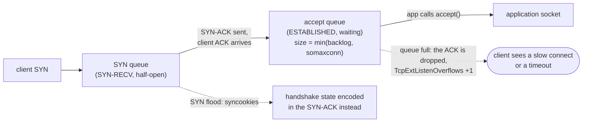

# 095 · TCP/IP Deep Dive: Sockets, Connection States, Netfilter and the Packet Path

> **You need first:** [094 · The storage I/O path](094-storage-io-path.md) (and topics 058–071 networking, 092 file descriptors)
> **Next:** [096 · Packet capture](096-packet-capture.md)

---

## What it is

Topics 058–071 configured networking: addresses, routes, DNS, firewall zones. This topic explains **behaviour**: what really happens on the wire and in the kernel when connections work, hang, time out or get reset.

| Term | Meaning |
|---|---|
| **Socket** | The kernel object a program uses for network communication; it's a **file descriptor** (topic 092) |
| **4-tuple** | (source IP, source port, destination IP, destination port): what identifies a TCP connection |
| **Ephemeral port** | The temporary source port the kernel picks for an outgoing connection |
| **TCP state** | Where a connection is in its life (LISTEN, ESTABLISHED, TIME-WAIT…) |
| **RST** (reset) | A TCP packet meaning "no" / "abort this connection" |
| **MTU** (Maximum Transmission Unit) | The largest packet an interface or path can carry (usually 1500 bytes) |
| **Netfilter** | The kernel framework with "hooks" where packets can be filtered or NATed; **nftables** writes rules into it |
| **Conntrack** | Connection tracking: the kernel's table of flows, used by stateful firewalls and NAT |
| **NAT** | Network Address Translation: rewriting source (SNAT) or destination (DNAT) addresses |

## Why it exists

Production network incidents are about behaviour:
- connections that hang;
- "Connection refused" vs timeouts;
- port exhaustion under load;
- thousands of sockets stuck in `CLOSE_WAIT`;
- a firewall rule silently dropping traffic;
- a black-holed MTU where small requests work but big ones hang.

With the right mental model you can tell these apart in minutes instead of hours.

## Analogy

A TCP connection is a **phone call**.
- **SYN / SYN-ACK / ACK** = "Hello?" "Hello, I hear you." "Great, I hear you too."
- **FIN** = "I'm done talking", and both sides must say it and hear it.
- **RST** = slamming the phone down.
- **Refused** = the number exists, but a recording says "nobody's on this line" (instant).
- **Timeout** = it rings forever, because someone cut the wire (a firewall drop).
- **CLOSE-WAIT** = the other person has said goodbye, but **you** never hang up, and your phone line stays busy forever.

## How it works inside

### 1. End to end: `curl https://api.example.com/health`

1. **Name resolution** (topic 063): nsswitch → `/etc/hosts` → DNS servers in `/etc/resolv.conf`.
2. **Route lookup** (topic 061): the longest-prefix match gives the outgoing interface, next hop and source IP.
3. **Neighbour resolution**: ARP (IPv4) or Neighbour Discovery (IPv6) finds the next hop's MAC address (`ip neigh`).
4. **TCP handshake**: the kernel picks an ephemeral source port, sends **SYN**, gets **SYN-ACK**, sends **ACK**. Packets pass netfilter's OUTPUT and POSTROUTING hooks.
5. **TLS** (topic 064): ClientHello with **SNI** (the hostname) → certificate chain → the client verifies the chain **and** the hostname → keys are agreed.
6. **HTTP** request and response (topic 070).
7. **Teardown**: FIN/ACK each way. The side that closes **first** ends in **TIME-WAIT**.

### 2. TCP connection lifecycle

```
 client                                  server (listening)
 SYN-SENT     ── SYN ──────────────────► SYN-RECV       (SYN queue)
 ESTABLISHED  ◄─ SYN-ACK ──────────────
              ── ACK ──────────────────► ESTABLISHED    (accept queue → accept())
              … data …
 FIN-WAIT-1   ── FIN ──────────────────► CLOSE-WAIT     ← the app must now call close()
 FIN-WAIT-2   ◄─ ACK ──────────────────
 TIME-WAIT    ◄─ FIN ────────────────── LAST-ACK       (after the app closes)
 (2×MSL)      ── ACK ──────────────────► CLOSED
```

| State | Meaning | A problem when… |
|---|---|---|
| `LISTEN` | A server socket waiting for connections | — |
| `SYN-SENT` | We sent SYN, no answer yet | Many = destination unreachable or **dropped** by a firewall |
| `SYN-RECV` | We got SYN, sent SYN-ACK, waiting for ACK | Many = SYN flood, or the return path is broken |
| `ESTABLISHED` | An open connection | Count vs expectations (pool sizes, leaks) |
| **`CLOSE-WAIT`** | The peer closed; **our application hasn't called `close()`** | **Always an application bug** when it piles up: leaked sockets → fd exhaustion |
| `FIN-WAIT-2` | We closed; waiting for the peer's FIN | The peer app is stuck (in CLOSE-WAIT on its side) |
| **`TIME-WAIT`** | We closed first; RFC 793 says hold it for 2×MSL (Maximum Segment Lifetime). Linux uses a fixed **60 s total** (`TCP_TIMEWAIT_LEN`, not tunable by sysctl), so stray packets can't corrupt a new connection | Huge numbers on a **client** making many short connections → ephemeral port exhaustion |

### 3. Listen queues

A listening socket has two queues:
- the **SYN queue** (half-open connections, in `SYN-RECV`);
- the **accept queue** (finished handshakes waiting for the app to call `accept()`).



`ss -lnt` shows the accept queue for each listener: `Recv-Q` = connections waiting now, `Send-Q` = the queue size.

The accept queue's size is `min(backlog given to listen(), net.core.somaxconn)` (`somaxconn` defaults to 4096). If the app accepts too slowly (saturated worker pool, blocked event loop), the queue fills and new connections are **dropped**, so clients see slow connects or timeouts. `net.ipv4.tcp_syncookies = 1` (the default) lets a server survive SYN floods.

### 4. Ephemeral port exhaustion

Outgoing connections take source ports from `net.ipv4.ip_local_port_range` (default `32768 60999`, about 28,000 ports). A client opening many short connections to the **same** destination IP:port can run out while old ones sit in TIME-WAIT. The symptom is `connect: Cannot assign requested address` (`EADDRNOTAVAIL`).

Fixes, best first:
1. **Reuse connections** (keep-alive, connection pools).
2. Spread over more destination IPs.
3. Widen the port range.
4. `net.ipv4.tcp_tw_reuse=1`.

`tcp_fin_timeout` controls FIN-WAIT-2, **not** TIME-WAIT.

### 5. Failure signatures

| The client sees | On the wire | Typical cause |
|---|---|---|
| `Connection refused` (instantly) | The host answered SYN with **RST** | Nothing listening on that port, the service bound to another address (127.0.0.1), or a firewall **reject** rule |
| A **timeout** (after seconds) | SYN got no answer | Firewall **drop**, host down, wrong route, broken return path, full SYN queue |
| `No route to host` | ICMP host-unreachable, or ARP failed | Host down on the local subnet, or a firewall rejecting with ICMP (firewalld's default reject) |
| `Network is unreachable` | No matching local route | Missing default route |
| `Connection reset by peer` mid-stream | RST on an established connection | The app crashed or closed abruptly; an idle timeout on a load balancer or NAT device |
| Connects, then hangs on TLS or big responses | Large packets dropped | **MTU black hole** (below) |

**`drop` vs `reject` = timeout vs instant error**: a key clue in firewall debugging.

### 6. MTU and Path MTU Discovery

TCP marks packets "Don't Fragment". A router that can't forward a big packet sends back ICMP "fragmentation needed", and the sender shrinks its packets: **PMTUD** (Path MTU Discovery). If a firewall drops that ICMP, large packets **vanish silently**: small requests work, TLS handshakes and large responses hang. This is common with VPNs, tunnels and overlay networks (VXLAN in Kubernetes), which have MTUs smaller than 1500.

### 7. Netfilter hooks

```
 incoming ─► PREROUTING ─► routing decision ─┬─► INPUT ─► local process
           (DNAT here)                         │
                                               └─► FORWARD ─► POSTROUTING ─► out   (router / container host)
 local process ─► OUTPUT ─► routing ─► POSTROUTING (SNAT / masquerade here) ─► out
```
- **INPUT**: traffic **to** this host (where firewalld zones act, topic 071).
- **FORWARD**: traffic routed **through** this host (routers, VM and container hosts, Kubernetes nodes).
- **DNAT** in PREROUTING/OUTPUT: change the destination (port forwarding, `podman -p 8080:80`, Kubernetes Service IPs with kube-proxy).
- **SNAT/masquerade** in POSTROUTING: change the source (VMs and containers reaching the internet through the host's IP).

**Conntrack** classifies each packet as `new`, `established`, `related` (for example, ICMP errors) or `invalid`. "Allow replies" is `ct state established,related accept`. NAT is recorded per flow, so replies are translated back automatically. If the conntrack table fills (`nf_conntrack_max`), **new connections are dropped**.

## Commands

### Time each phase of a request

```bash
curl -sS -o /dev/null -w 'dns=%{time_namelookup} connect=%{time_connect} tls=%{time_appconnect} ttfb=%{time_starttransfer} total=%{time_total} code=%{http_code}\n' https://www.redhat.com/
```
```
dns=0.453051 connect=0.498890 tls=0.651510 ttfb=0.735526 total=0.736675 code=301
```
- The values are **cumulative**: DNS took 453 ms (a slow resolver!), TCP 46 ms, TLS 153 ms, server processing about 84 ms. The dominant phase tells you where to look.

### ss: socket statistics

```bash
sudo ss -tlnp                     # TCP listeners + owning process
sudo ss -ulnp                     # UDP listeners
ss -s                             # totals per state
ss -tan state close-wait          # filter by state (also established, time-wait, syn-sent…)
ss -tan '( dport = :443 or sport = :443 )'
ss -ti dst 10.0.0.15              # per-connection internals
```
```
State      Recv-Q Send-Q Local Address:Port  Peer Address:Port
CLOSE-WAIT 1      0          127.0.0.1:9000     127.0.0.1:41538     ← server side: the app never closed
FIN-WAIT-2 0      0          127.0.0.1:41538    127.0.0.1:9000      ← client side, waiting for the server's FIN
```
- A server that accepts connections but never closes them. When the server process was killed, the kernel closed its sockets and the clients moved to TIME-WAIT.

```
ESTAB 0 0 10.0.0.5:51234 10.0.0.15:443
	 cubic wscale:7,7 rto:204 rtt:3.1/1.2 mss:1448 cwnd:10 retrans:0/5 …
```

| `ss -i` field | Meaning |
|---|---|
| `rtt:3.1/1.2` | Smoothed round-trip time / its variation (ms) |
| `cwnd:10` | Congestion window (segments in flight allowed) |
| `retrans:0/5` | Current / total retransmissions: **packet loss** on the path |
| `mss:1448` | Maximum segment size (reveals the MTU: 1448 + 52 bytes of headers = 1500) |

### Listen queue overflow

```bash
ss -ltn 'sport = :9000'
nstat -az TcpExtListenOverflows TcpExtListenDrops
```
```
State  Recv-Q Send-Q Local Address:Port
LISTEN 5      5          127.0.0.1:9000
TcpExtListenOverflows           37                 0.0
TcpExtListenDrops               37                 0.0
```
- For a **LISTEN** socket, `Recv-Q` = connections waiting in the accept queue and `Send-Q` = its maximum. 5/5 = full, and the overflow counters are rising: the application isn't accepting fast enough.

```bash
nstat -az | grep -iE 'retrans|overflow|drop'    # protocol counters (netstat -s is the older tool)
```

### MTU checks

```bash
ip link show eth0 | grep -o 'mtu [0-9]*'
ping -M do -s 1472 -c 3 HOST     # 1472 + 8 (ICMP) + 20 (IP) = 1500: must pass on a 1500 path
ping -M do -s 1473 -c 3 HOST     # one byte too many
tracepath HOST                   # reports "pmtu N" along the path
```
```
ping: local error: message too long, mtu=1500
```
Fixes: allow ICMP "fragmentation needed" (IPv4 type 3 code 4) / ICMPv6 "packet too big" through firewalls; set the right MTU (`nmcli con mod X 802-3-ethernet.mtu 1450`); MSS clamping on the router.

### Neighbours

```bash
ip neigh
```
```
192.168.56.1 dev enp0s8 lladdr 0a:00:27:00:00:0b REACHABLE
192.168.56.20 dev enp0s8 FAILED
```
- `REACHABLE` = recently confirmed; `STALE` = cached, re-checked on use; `FAILED`/`INCOMPLETE` = no ARP answer (host down, wrong VLAN or subnet). **A gateway in `FAILED` explains "everything off-subnet times out".**

### nftables and conntrack

```bash
sudo nft list ruleset | less         # firewalld's rules live in "table inet firewalld"
sudo nft add table inet lab
sudo nft add chain inet lab input '{ type filter hook input priority 0; }'
sudo nft add rule inet lab input tcp dport 9002 drop
sudo nft add rule inet lab input tcp dport 9003 reject with tcp reset
sudo nft list table inet lab
sudo nft delete table inet lab
```
```
table inet lab {                                   ← a table: a namespace for chains; inet = IPv4 + IPv6
	chain input {                                  ← a base chain attached to the input hook
		type filter hook input priority filter; policy accept;
		tcp dport 9002 drop                        ← a rule: match + verdict
		tcp dport 9003 reject with tcp reset
	}
}
```
- Connecting to 9002 **times out** after seconds; 9003 gives **`Connection refused` instantly**.
- On RHEL, manage the host firewall with firewalld and use `nft` to **read** what it generated, or for lab experiments.

```bash
cat /proc/sys/net/netfilter/nf_conntrack_count /proc/sys/net/netfilter/nf_conntrack_max
sudo conntrack -L | head         # conntrack-tools package
sudo dmesg | grep -i 'nf_conntrack: table full'
```

### The "service X is unreachable" flow

```
1. Is it listening, and on which address?    ss -tlnp | grep :PORT        (0.0.0.0 vs 127.0.0.1)
2. Does a local test work?                   curl -v http://127.0.0.1:PORT/
3. Local firewall / SELinux?                 firewall-cmd --list-all ; ausearch -m avc -ts recent
4. Route and neighbour from the client?      ip route get SERVER ; ip neigh
5. Does the SYN arrive? Does a SYN-ACK leave?   tcpdump -nn -i any port PORT   (topic 096)
6. Refused / timeout / reset?                → the failure signatures table
7. Is name resolution right?                 getent hosts NAME vs dig NAME
8. TLS?                                      openssl s_client -connect HOST:443 -servername HOST
```

### Try it
1. Use the `curl -w` line against three sites and name the slowest phase of each.
2. Run a tiny Python server that accepts and never closes; connect several clients and watch `ss -tan state close-wait` grow, along with the server's fd count.
3. Add `drop` and `reject` rules on two ports (nft or firewalld rich rules) and time `curl` against each.
4. Write a server with `listen(1)` that sleeps before `accept()`; open 20 connections and watch `Recv-Q` and `TcpExtListenOverflows`.

**Check your work:** on your lab VM, from the notes folder, run `sudo ./checks/check 095` for every step, or `sudo ./checks/check 095 STEP` for one (topic 002 shows how to get the notes there).

## Where you'll use it

- **Kubernetes:**
  - Services are DNAT rules (kube-proxy in iptables/nftables mode) plus conntrack.
  - "conntrack table full" on busy nodes drops connections.
  - Overlay networks lower the MTU, so MTU black holes are classic.
  - Pods with `ndots:5` make extra DNS queries.
  - Readiness probes failing with "connection refused" means nothing is listening yet.
- **Microservices:** CLOSE-WAIT leaks in HTTP clients, ephemeral port exhaustion without connection pooling, load-balancer idle timeouts causing resets.
- **Incident triage:** refused vs timeout vs reset decides whether you look at the app, the firewall or the network.

## When it breaks

| Symptom | Likely cause | Check |
|---|---|---|
| CLOSE-WAIT keeps growing | The app doesn't close sockets | `ss -tanp state close-wait`; fix the app; meanwhile, restart |
| `Cannot assign requested address` on connect | Ephemeral port exhaustion | `ss -s` (timewait count); pooling, port range, `tcp_tw_reuse` |
| Slow or failing connects under load, server fine at low load | Accept queue overflow | `ss -ltn`, `nstat TcpExtListenOverflows`; more workers, bigger backlog |
| Timeouts to one port only | A firewall drop | `nft list ruleset`, `firewall-cmd --list-all`, tcpdump |
| Small requests OK, large ones hang | MTU black hole | `ping -M do -s …`, `tracepath`; allow ICMP, fix the MTU |
| Random new connections dropped on a busy NAT/k8s node | Conntrack table full | `dmesg`, `nf_conntrack_count/max` |
| Retransmissions climbing | Packet loss on the path | `ss -ti`, `nstat`, interface errors (`ip -s link`) |

## Quick recap

- Handshake SYN → SYN-ACK → ACK. The closer ends in **TIME-WAIT**; the other side sits in **CLOSE-WAIT** until its app calls `close()` (a pile-up = leak).
- LISTEN `Recv-Q`/`Send-Q` = accept queue / backlog; overflows show in `nstat`.
- **Refused** = RST (no listener/reject), **timeout** = drop, **reset by peer** = abrupt close, **big packets hang** = MTU black hole.
- `ss -tlnp`, `ss -s`, `ss -ti`, `nstat -az`, `ip neigh`, `ping -M do`, `tracepath`.
- Netfilter: PREROUTING (DNAT) → INPUT / FORWARD → OUTPUT → POSTROUTING (SNAT). Conntrack keeps state; a full table drops new flows.

**Interview questions**

1. *CLOSE-WAIT vs TIME-WAIT?* CLOSE-WAIT means the peer closed and our application hasn't called `close()` (a pile-up is a socket leak). TIME-WAIT is normal on the side that closed first; it lasts about 60 s, but many of them can exhaust a client's ephemeral ports.
2. *"Connection refused" vs a timeout?* Refused means the host answered with a TCP RST (nothing listening, or a reject rule). A timeout means the SYN got no answer at all (dropped by a firewall, host down, or a routing problem).
3. *Where does NAT happen in netfilter?* DNAT in PREROUTING (and OUTPUT for local traffic); SNAT/masquerade in POSTROUTING. Conntrack remembers each translation so replies are rewritten back automatically.

**Scenario question** (answer out loud first, then compare)

> *"An API server works for hours, then new clients start timing out while existing ones are fine. `ss -s` shows thousands of sockets. How do you diagnose it?"*

**Model answer:**
1. Look at socket **states**: `ss -tan | awk '{print $1}' | sort | uniq -c`.
   - Thousands of **CLOSE-WAIT** on the server: the app isn't closing connections the clients closed. A leak eats fds and workers.
   - Thousands of **TIME-WAIT** on a client or proxy making many short connections: possible ephemeral port exhaustion (`ip_local_port_range`).
2. Check the **listen queue**: `ss -lnt sport = :443`. If `Recv-Q` is at `Send-Q` (the backlog), the accept queue is full. Confirm with `nstat -az TcpExtListenOverflows TcpExtListenDrops` rising.
3. Check fds: `ls /proc/PID/fd | wc -l` against `/proc/PID/limits`.
4. Check conntrack if a firewall or NAT is in the path: `nf_conntrack: table full` in `dmesg`.
5. Fix the cause (close sockets, size worker pools, connection reuse), not just bigger limits.

**Likely follow-ups:**
- *Refused vs timeout vs reset?* Refused = RST to the SYN; timeout = no answer (dropped); reset by peer = an established connection aborted.
- *Small requests work, big ones hang. What's that?* An MTU black hole: PMTUD's ICMP "fragmentation needed" is blocked.
