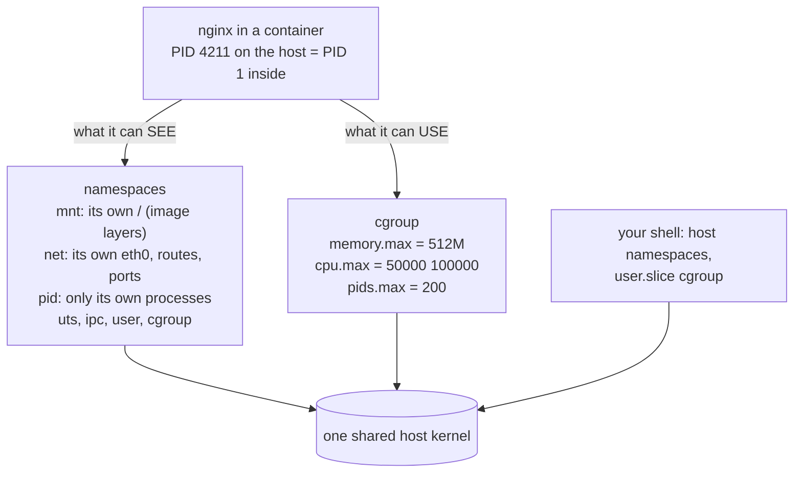

# 097 · Namespaces, cgroups and How Containers Are Built

> **You need first:** [096 · Packet capture](096-packet-capture.md) (and topics 092 processes, 093 memory, 095 netfilter)
> **Next:** [098 · systemd unit files in depth](098-systemd-unit-files.md)

---

## What it is

A **container is not a small virtual machine.** It is an ordinary Linux process tree that the kernel:
- shows a **different view** of the system (**namespaces**: what a process can *see*);
- **limits** in resources (**cgroups**, control groups: what a process can *use*);
- **restricts** in privileges (capabilities, seccomp, SELinux, user namespaces);

and that runs on a layered root filesystem (**overlayfs**).

```
container = clone(namespaces) + cgroup(limits) + overlayfs root + pivot_root
          + dropped capabilities + seccomp filter + SELinux label (container_t:s0:cX,cY) [+ user namespace]
```

The same mechanisms power **systemd's** per-service limits (topic 098).

## Why it exists

Every container problem is one of these mechanisms at work:
- OOMKilled
- CPU throttled
- permission denied as root
- can't see the host's processes
- PID 1 won't stop

Namespaces and cgroups let one kernel run many isolated workloads with far less overhead than VMs (topic 099). Understanding them is the core of Kubernetes troubleshooting.

## Analogy

The host is an **apartment building**:
- **Namespaces** are the **walls and private front doors**: each tenant sees only their own rooms, mailbox (network) and doorbell name (hostname), even though they share the building.
- **cgroups** are the **utility meters with breakers**: each flat gets a capped amount of electricity (CPU) and water (memory); exceed it, and the breaker trips (throttling or OOM kill).
- **Capabilities, seccomp and SELinux** are the **building rules**: tenants can't touch the boiler room even if they call themselves "owner".
- **Overlayfs** is a **furnished flat**: the landlord's furniture (image layers) stays untouched, and anything you add or move is tracked on your own inventory (the writable layer).

## How it works inside

### 1. Namespaces: what a process can see

| Namespace | Isolates | `unshare` flag | Container effect |
|---|---|---|---|
| **mnt** | Mount table | `--mount` | Its own root filesystem and mounts |
| **pid** | PID numbers | `--pid --fork` | The container's first process is PID 1 (topic 092) |
| **net** | Interfaces, addresses, routes, firewall, sockets | `--net` | Its own `eth0` and `localhost` |
| **uts** | Hostname | `--uts` | Its own hostname |
| **ipc** | SysV IPC, POSIX message queues | `--ipc` | Shared-memory isolation |
| **user** | UID/GID mappings, scope of capabilities | `--user` | Root inside = an unprivileged user outside (**rootless**) |
| **cgroup** | The view of the cgroup tree | `--cgroup` | The container sees its own cgroup as `/` |
| **time** | Boot/monotonic clock offsets | `--time` | Rarely used |

What one container process actually is: an ordinary host process with its own namespaces (what it can **see**) and a cgroup (what it can **use**):



- New namespaces are created with the `clone()` flags (`CLONE_NEWPID`, `CLONE_NEWNET`…) or `unshare()`.
- An existing one is joined with `setns()`; `nsenter` and `podman exec` do this.
- Every process has a link per namespace in `/proc/PID/ns/`. Two processes share a namespace when the inode numbers match.

### 2. cgroups v2: what a process can use

A cgroup is a **directory** under `/sys/fs/cgroup/`, holding member processes and **controller** files. RHEL 10 supports **cgroups v2 only** (one unified tree).

```
/sys/fs/cgroup/                         ← root
├── init.scope/                         ← PID 1
├── system.slice/                       ← system services
│   ├── sshd.service/   (cgroup.procs, memory.max, cpu.max, pids.max …)
│   └── httpd.service/
├── user.slice/user-1000.slice/session-3.scope/   ← login sessions
└── machine.slice/                      ← VMs and rootful containers
```

| Controller | Key files | Meaning |
|---|---|---|
| **memory** | `memory.current`, `memory.max`, `memory.high`, `memory.swap.max`, `memory.events`, `memory.stat`, `memory.pressure` | Usage; hard limit (→ OOM kill); throttle threshold; swap limit; counters (`oom_kill`…) |
| **cpu** | `cpu.max` (`QUOTA PERIOD`), `cpu.weight` (1–10000, default 100), `cpu.stat`, `cpu.pressure` | Bandwidth cap; relative share under contention; usage and **throttling** stats |
| **pids** | `pids.max`, `pids.current`, `pids.events` | Maximum tasks (processes + threads): fork-bomb protection |
| **io** | `io.max`, `io.weight`, `io.stat`, `io.pressure` | Per-device bandwidth/IOPS limits and weights |
| **cpuset** | `cpuset.cpus`, `cpuset.mems` | Pin to CPUs / NUMA nodes |
| core | `cgroup.procs`, `cgroup.controllers`, `cgroup.subtree_control`, `cgroup.kill` | Members; available controllers; controllers enabled for children; kill everything |

**Rules that trip people up:**
- A controller works in a child **only if it's enabled in the parent's `cgroup.subtree_control`**.
- **No internal processes:** apart from the root, a cgroup that hands controllers to its children can't hold processes itself. That's why systemd puts processes in leaf `.service`/`.scope` cgroups.
- **On a systemd host, let systemd own the tree.** Use unit properties, `systemd-run` or `systemctl set-property`. The manual `mkdir` steps below are for **learning in a lab**.

**CPU quota vs weight:**
- `cpu.max 20000 100000` = 20 ms of CPU per 100 ms period = 20% of one CPU. A process that uses its quota early in a period is **throttled** (made to wait) until the next period, **even if the rest of the machine is idle**. This is the famous "pod CPU-throttled at 30% node usage".
- `cpu.weight` only matters when CPUs are contended, and never throttles.

**Memory max vs high:** above `memory.high` the cgroup is slowed down and reclaimed; at `memory.max` the **cgroup OOM killer** kills a process inside it, regardless of how much RAM the host has free (topic 093).

### 3. Overlay filesystem: image layers

Images are stacks of read-only **lower** layers. A running container adds a writable **upper** layer, and overlayfs merges them:
- Modifying a lower file **copies it up** into the upper layer first.
- Deleting a lower file creates a **whiteout** (a 0,0 character device) in the upper layer that hides it.
- The image layers are never changed.

Consequences:
- Deleting a file in a later image layer doesn't shrink the image.
- Data written inside the container is slow and lost when the container is removed, so use **volumes**.

### 4. Privilege reduction

| Mechanism | In a default container | Inspect |
|---|---|---|
| **Capabilities** | Container root keeps about 14 (e.g. `cap_chown`, `cap_net_bind_service`); no `CAP_SYS_ADMIN`, `CAP_NET_ADMIN`, `CAP_SYS_MODULE` | `grep Cap /proc/PID/status`; `--cap-add`/`--cap-drop` |
| **seccomp** (secure computing) | A syscall filter blocks dangerous calls (`kexec_load`, most `mount` calls, keyring operations) | `grep Seccomp /proc/PID/status` (2 = filter active) |
| **SELinux** | Processes run as `container_t` with a unique **MCS category pair**, files as `container_file_t` (topic 076) | `ps -eZ \| grep container_t`; `:Z`/`:z` on bind mounts |
| **User namespace** | Container UID 0 maps to your UID; other UIDs to your `/etc/subuid` range | `podman unshare cat /proc/self/uid_map` |
| **no_new_privs** | Set-UID binaries can't escalate | `grep NoNewPrivs /proc/PID/status` |

So "root in a container" = UID 0 in a user namespace (perhaps an unprivileged host user), with few capabilities, filtered syscalls, a confined SELinux domain and a cgroup limit. **`--privileged` turns most of that off; avoid it.**

## Commands

All of these need root and change kernel state: **use a lab VM**.

### Namespaces

```bash
lsns -t net,pid
ls -l /proc/$$/ns
```
```
        NS TYPE NPROCS   PID USER COMMAND
4026531840 pid     148     1 root /usr/lib/systemd/systemd --switched-root --system
4026531833 net     148     1 root /usr/lib/systemd/systemd --switched-root --system
4026532695 net       2  4120 root /catatonit -P
lrwxrwxrwx. 1 alice alice 0 Nov 17 12:01 net -> 'net:[4026531833]'
...
```
- One extra network namespace, owned by a container (catatonit is Podman's init). Your shell shares the host's `net:[4026531833]`.

```bash
sudo unshare --fork --pid --mount-proc --uts bash -c 'hostname inside-ns; echo inside: $(hostname); echo my PID: $$; ps -ef'
hostname
```
```
inside: inside-ns
my PID: 1
UID          PID    PPID  C STIME TTY          TIME CMD
root           1       0  0 01:31 ?        00:00:00 ps -ef
server1.example.com
```
- Inside: its own hostname, the first process is **PID 1**, and `ps` sees only itself (`--mount-proc` mounted a fresh `/proc`). Outside, the hostname is unchanged.
- Why is `ps` PID 1 and not bash? Bash `exec`s the **last** command of a `-c` string instead of forking it, so `ps` replaced the shell. Add `; true` at the end and you'll see bash as PID 1 and `ps` as a child.

```bash
unshare --user --map-root-user bash -c 'id; cat /proc/self/uid_map; touch /etc/x'     # as a NORMAL user
```
```
uid=0(root) gid=0(root) groups=0(root),65534(nobody) context=unconfined_u:unconfined_r:unconfined_t:s0-s0:c0.c1023
         0       1000          1
touch: cannot touch '/etc/x': Permission denied
```
- "root" inside maps to UID 1000 outside, so the host's real permissions still apply. This is the basis of **rootless containers**. Your other groups can't be mapped without help, so they show up as `65534(nobody)`.

### Network namespaces, veth and NAT: container networking by hand

A **veth pair** is a virtual cable: whatever enters one end comes out of the other.

```bash
sudo ip netns add red
sudo ip link add veth-host type veth peer name veth-red
sudo ip link set veth-red netns red                          # move one end into the namespace
sudo ip addr add 10.200.0.1/24 dev veth-host ; sudo ip link set veth-host up
sudo ip -n red addr add 10.200.0.2/24 dev veth-red ; sudo ip -n red link set veth-red up ; sudo ip -n red link set lo up
ping -c1 10.200.0.2                                          # host → namespace works
sudo ip netns exec red ping -c1 1.1.1.1                      # "Network is unreachable": no default route
```
Give it internet access, exactly as Podman (netavark) and Kubernetes CNI plugins do:
```bash
sudo ip -n red route add default via 10.200.0.1
sudo sysctl -w net.ipv4.ip_forward=1
sudo nft add table ip natlab
sudo nft add chain ip natlab post '{ type nat hook postrouting priority 100; }'
sudo nft add rule ip natlab post ip saddr 10.200.0.0/24 masquerade      # SNAT in POSTROUTING (topic 095)
sudo ip netns exec red ping -c1 1.1.1.1                                  # works now
sudo ip netns del red ; sudo nft delete table ip natlab                  # clean up
```
Real runtimes attach many veths to a **bridge** (`podman0`, `cni0`), and add DNAT rules for published ports.

### cgroups: memory limit by hand (lab)

```bash
sudo mkdir /sys/fs/cgroup/demo
echo 50M | sudo tee /sys/fs/cgroup/demo/memory.max
echo 0   | sudo tee /sys/fs/cgroup/demo/memory.swap.max
sudo bash -c 'echo $$ > /sys/fs/cgroup/demo/cgroup.procs; cat /proc/self/cgroup; python3 -c "b=bytearray(200*1024*1024)"'; echo rc=$?
grep -E '^(oom|oom_kill) ' /sys/fs/cgroup/demo/memory.events
```
```
0::/demo
Killed
rc=137
oom 1
oom_kill 1
```
- This **is** an OOMKilled container: the cgroup hit `memory.max`, a process inside was killed with SIGKILL (137), and the host's free memory didn't matter.

### CPU quota and throttling (lab)

```bash
sudo mkdir /sys/fs/cgroup/cpudemo
grep -qw cpu /sys/fs/cgroup/cgroup.subtree_control || echo +cpu | sudo tee /sys/fs/cgroup/cgroup.subtree_control
echo "20000 100000" | sudo tee /sys/fs/cgroup/cpudemo/cpu.max
sudo bash -c 'echo $$ > /sys/fs/cgroup/cpudemo/cgroup.procs; timeout 3 bash -c "while :; do :; done"'
grep -E 'usage_usec|nr_periods|nr_throttled|throttled_usec' /sys/fs/cgroup/cpudemo/cpu.stat
```
```
usage_usec 620917
nr_periods 31
nr_throttled 31
throttled_usec 2401469
```
- 0.62 s of CPU in 3 s (≈ 20%), throttled in **every** period, 2.4 s spent waiting. Watch `nr_throttled` grow, not just CPU utilisation.

### Process limit (lab)

```bash
sudo mkdir /sys/fs/cgroup/pidsdemo ; echo 5 | sudo tee /sys/fs/cgroup/pidsdemo/pids.max
sudo bash -c 'echo $$ > /sys/fs/cgroup/pidsdemo/cgroup.procs; for i in 1 2 3 4 5 6; do sleep 5 & done; wait'
cat /sys/fs/cgroup/pidsdemo/pids.events
```
```
bash: fork: retry: Resource temporarily unavailable
max 3
```
Clean up: `sudo rmdir /sys/fs/cgroup/{demo,cpudemo,pidsdemo}` (once they're empty).

### The systemd way (persistent, use this in real life)

```bash
systemd-cgls --no-pager | head -20                     # the tree: slices → units → processes
systemd-cgtop                                          # live CPU / memory / IO per cgroup
cat /proc/$(pgrep -o sshd)/cgroup                      # 0::/system.slice/sshd.service
sudo systemd-run --unit=job1 -p MemoryMax=1G -p CPUQuota=50% -p TasksMax=100 /usr/local/bin/batch.sh
sudo systemctl set-property httpd.service MemoryMax=2G CPUWeight=200
systemctl show httpd -p MemoryMax -p CPUWeight -p TasksMax
```

### Overlayfs by hand

```bash
sudo mkdir -p /mnt/ov ; sudo mount -t tmpfs tmpfs /mnt/ov ; cd /mnt/ov
sudo mkdir lower upper work merged
echo base | sudo tee lower/a.txt ; echo keep | sudo tee lower/b.txt
sudo mount -t overlay overlay -o lowerdir=lower,upperdir=upper,workdir=work merged
echo changed | sudo tee merged/a.txt ; sudo rm merged/b.txt ; echo new | sudo tee merged/c.txt
ls -l upper ; cat lower/a.txt
```
```
-rw-r--r--. 1 root root    8 Nov 17 12:20 a.txt     ← copy-up: the modified file lives in upper
c---------. 2 root root 0, 0 Nov 17 12:20 b.txt     ← whiteout hides the deleted lower file
-rw-r--r--. 1 root root    4 Nov 17 12:20 c.txt     ← new files go to upper
base                                                ← the lower (image) layer is untouched
```

### Assemble a container by hand (advanced lab)

Roughly what `crun`, Podman's OCI runtime, does:
```bash
sudo mkdir -p /srv/ctr/rootfs
podman export "$(podman create registry.access.redhat.com/ubi10/ubi)" | sudo tar -x -C /srv/ctr/rootfs
sudo mkdir /sys/fs/cgroup/myctr ; echo 100M | sudo tee /sys/fs/cgroup/myctr/memory.max
sudo unshare --mount --uts --ipc --net --pid --fork bash -c '
  echo $$ > /sys/fs/cgroup/myctr/cgroup.procs
  hostname myctr
  mount --make-rprivate /
  cd /srv/ctr/rootfs && mount --bind . . && cd /srv/ctr/rootfs && mkdir -p old && pivot_root . old
  cd / && mount -t proc proc /proc && umount -l /old
  exec /bin/bash'
```
Inside: the hostname is `myctr`, `/proc` shows only your processes, `/proc/self/cgroup` says `/myctr`, and `/etc/redhat-release` is the image's. Compare with `podman run --rm -it --memory 100m ubi10/ubi bash`: the same kernel objects, plus networking, capabilities, seccomp and SELinux set up for you.

### Try it
1. Run the `unshare` PID/UTS demo and the rootless user-namespace demo.
2. Build the `red` namespace with internet access, then `tcpdump -i veth-host` while pinging from inside (topic 096).
3. Reproduce the memory OOM and CPU throttling in hand-made cgroups; then do the same with `systemd-run -p MemoryMax=50M` and `-p CPUQuota=20%`.
4. Start a Podman container, find its PID (`podman inspect -f '{{.State.Pid}}' NAME`), and compare `/proc/PID/ns/*`, `/proc/PID/cgroup` and `grep Cap /proc/PID/status` with your shell's.

**Check your work:** on your lab VM, from the notes folder, run `sudo ./checks/check 097` for every step, or `sudo ./checks/check 097 STEP` for one (topic 002 shows how to get the notes there).

## Where you'll use it

- **Kubernetes:**
  - Pod `limits.memory` → `memory.max` (OOMKilled).
  - `limits.cpu` → `cpu.max` (throttling).
  - `requests.cpu` → `cpu.weight`.
  - Each pod shares one network namespace (held by the "pause" container).
  - `kubectl debug`/`nsenter` join a pod's namespaces.
  - QoS classes map to cgroup slices.
- **systemd services:** `MemoryMax=`, `CPUQuota=`, `TasksMax=` are the same cgroup files (topic 098).
- **Security reviews:** spotting `--privileged`, host namespaces (`--pid=host`, `--network=host`) and extra capabilities.

## When it breaks

| Symptom | Mechanism | Check |
|---|---|---|
| No `cpu.pressure`/`memory.pressure` files in a cgroup | PSI is disabled by default on RHEL kernels | Boot with `psi=1` (topic 103) |
| Killed with exit 137 while the host has free RAM | cgroup `memory.max` | `memory.events` (`oom_kill`), `memory.current`, `memory.stat`; kernel log |
| High latency, CPU looks idle | `cpu.max` throttling | `cpu.stat` `nr_throttled`, `throttled_usec`; `cpu.pressure` |
| `fork: Resource temporarily unavailable` | `pids.max` (or `ulimit -u`) | `pids.events`; `TasksMax=` |
| "Permission denied" as root inside a container | Missing capability, seccomp, SELinux or user-namespace mapping | `grep Cap /proc/1/status` inside; `ausearch -m avc`; test with one `--cap-add` |
| A bind mount is unreadable | SELinux label | `:Z`/`:z`; `ls -Z` |
| The container sees host processes or network | A namespace wasn't created (`--pid=host`, `--network=host`) | `podman inspect`; compare `/proc/PID/ns/*` inodes |
| Can't write `cpu.max` in a new cgroup | The controller isn't enabled in the parent's `subtree_control` | `cat cgroup.subtree_control` |
| `rmdir` of a cgroup says `Device or resource busy` | Processes are still inside | `cat cgroup.procs`; `echo 1 > cgroup.kill` |

## Quick recap

- Container = **namespaces** (see) + **cgroups** (use) + overlayfs + `pivot_root` + capabilities/seccomp/SELinux/user namespace (privilege).
- Namespaces: mnt, pid, net, uts, ipc, user, cgroup, time. Tools: `lsns`, `/proc/PID/ns`, `unshare`, `nsenter`, `ip netns`.
- cgroups v2: `/sys/fs/cgroup`; `memory.max` (OOM), `memory.high` (throttle), `cpu.max` (quota → throttling), `cpu.weight`, `pids.max`. Let **systemd** manage them (`systemd-run`, `set-property`).
- Overlayfs: read-only lower layers + writable upper; copy-up and whiteouts. Data belongs in volumes.
- Rootless = a user namespace mapping container root to your UID. `--privileged` removes the protections.

**Interview questions**

1. *What is a container, technically?* A normal process tree placed in its own namespaces, limited by a cgroup, with reduced capabilities, a seccomp filter and an SELinux label, running on an overlay root filesystem.
2. *Namespaces vs cgroups?* Namespaces control what a process can **see** (PIDs, network, mounts, hostname, users); cgroups control what it can **use** (CPU, memory, PIDs, I/O).
3. *Why is a container CPU-throttled while the host is only 30% busy?* Its CPU limit is a `cpu.max` quota; it uses its quota early in each 100 ms period and must wait for the next, regardless of idle CPUs elsewhere. `cpu.stat` `nr_throttled` shows it.

**Scenario question** (answer out loud first, then compare)

> *"A service running in a container on a 16-core host is slow, but host CPU usage is only 25%. What do you check?"*

**Model answer:**
1. Find the container's process and cgroup: `podman inspect -f '{{.State.Pid}}' NAME`, then `cat /proc/PID/cgroup`.
2. Read the cgroup's CPU limit and stats: `cpu.max` (for example `100000 100000` = 1 CPU) and `cpu.stat`. If `nr_throttled` and `throttled_usec` keep rising, the container uses its **quota** early in each 100 ms period and then waits, **even though other cores are idle**.
3. Fixes:
   - raise or remove the quota for that workload;
   - make the app use fewer threads, so it fits the quota;
   - rely on `cpu.weight` (a share, which never throttles) instead of a hard cap.
4. Also rule out memory pressure (`memory.events` `high`/`max` counters, PSI) and I/O limits (`io.max`).

**Likely follow-ups:**
- *Namespaces vs cgroups?* Namespaces limit what a process can see; cgroups limit what it can use.
- *What does rootless mean?* A user namespace maps root inside the container to your unprivileged UID outside.
